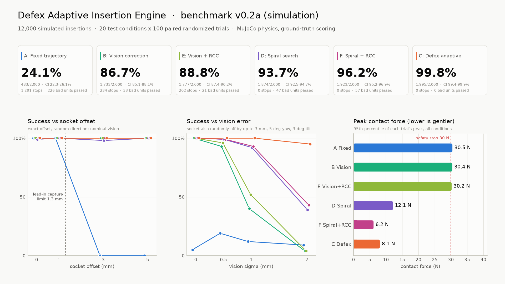
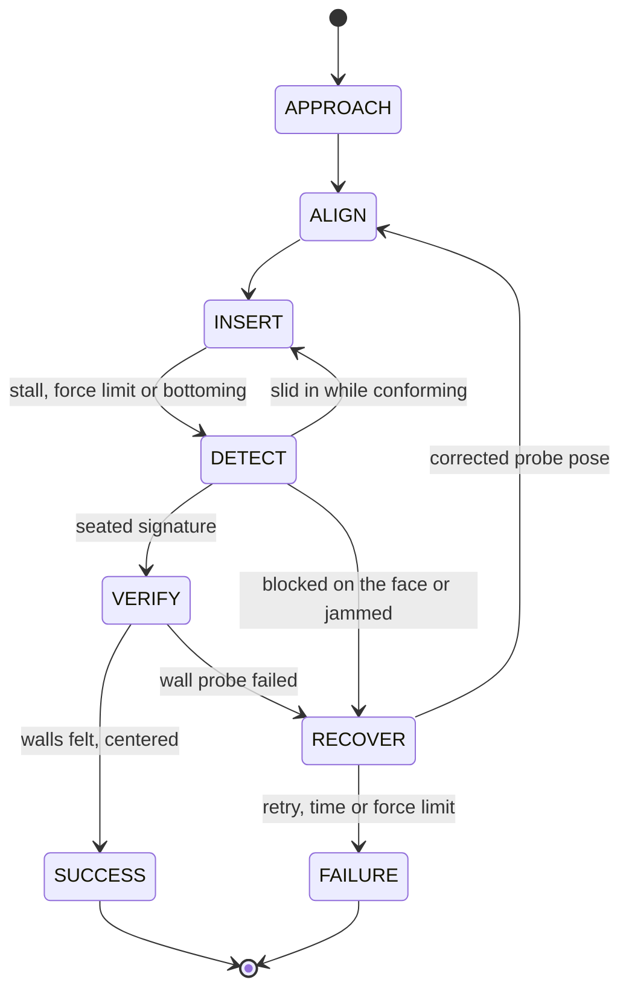

# Defex Adaptive Insertion Engine (DAIE), V0.2 in progress

DAIE is a simulation prototype of autonomous connector insertion. A 6-DOF fixture
holds a 12 x 8 mm rectangular connector and has to seat it 15 mm deep in a
receptacle with 0.5 mm of radial clearance, while the receptacle is displaced by up
to 5 mm and rotated by up to 10 degrees, the camera estimate of where it sits is
noisy, and the contact friction varies. The engine approaches, estimates alignment,
attempts the insertion, detects excessive force or insufficient progress from the
wrist force/torque sensor, retracts and corrects, retries within hard limits, and
verifies the result before it declares success.

Everything here runs in MuJoCo with a real socket cavity, bounded actuators and
noisy sensors, on two machines: a gantry fixture and a UR5e arm (MuJoCo
Menagerie). Every benchmark number in this README comes from the files in
[`results/benchmark_v0.2c`](results/benchmark_v0.2c) unless it is marked as
benchmark_v0.2b ([`results/benchmark_v0.2b`](results/benchmark_v0.2b)),
benchmark_v0.2a ([`results/benchmark_v0.2a`](results/benchmark_v0.2a)), V0.1
([`results/benchmark_v0.1`](results/benchmark_v0.1)) or a development
measurement. The physics behavior is pinned by the test suite (see
[Validation](#validation)). This is a research prototype: it has not been
validated on hardware (see [Limitations](#assumptions-and-limitations)).

## Results: benchmark_v0.2c, two machines, conventional cells with the same pull test

Pre-registered ([`PREREGISTRATION.md`](results/benchmark_v0.2c/PREREGISTRATION.md),
code frozen at 45f8b06): seed 20261116, gantry and UR5e arm, nine controllers,
four suites, 86,400 paired trials. Full report:
[`results/benchmark_v0.2c/REPORT.md`](results/benchmark_v0.2c/REPORT.md); every
table is regenerated from the per-trial rows by
`python -m experiments.checkpoint_report results/benchmark_v0.2c` and
`python -m experiments.v02c_paired results/benchmark_v0.2c`.

The controllers: **A** fixed program, **B** vision correction, **C** Defex
adaptive, **D** force-controlled spiral search, **E** B on a passive compliance
(RCC) device, **F** spiral search on the RCC device, **G** C plus a learned
contact prior, and new in this run **H** and **I**: D and F with C's retention
pull test. D, E, F, H and I are the conventional cells. Since Checkpoint 2, D, E
and F were tuned for the arm and re-tuned on the gantry with the latching
connector, and C's latch check now uses datasheet forces instead of the
simulator's latch geometry. The suites: `standard` (20 conditions,
housing-only connector), `latching` (Molex Micro-Fit 3.0, 3 good-part conditions,
4 deliberately bad parts), the mis-characterized-vision families (the camera is
worse than the cell is told) and `latch_spread` (good and bad Micro-Fit parts
whose latch and terminal forces vary within or at the edge of the datasheet).

**Headline, as the pre-registered rules require.**

* **On latching good parts, the best conventional cell seats more than C on
  both machines**: gantry F and I 99.2% against C 95.7% (McNemar p = 4.9e-5);
  arm F 96.5% and I 96.2% against 93.7% (p = 0.012 and 0.028).
* **With the camera worse than the cell believes, F and I match C on both
  machines**: gantry 84.0% against 85.8% (p = 0.4), arm 78.8% against 78.0%
  (p = 0.78).
* **With the same pull test, the conventional cells pass no bad parts either.**
  C, H and I each passed 0 of 2,200 deliberately bad latching parts (Wilson 95%
  upper bound 0.17%); D and F, which check depth only, passed 1,174 and 1,468.
  Checkpoint 2's bad-part result came from having a pull test.

C leads every conventional cell on the standard suite (gantry 99.0% against
96.6%, p < 1e-6; arm 97.6% against 96.4%, p = 0.0027) and on latch_spread good
parts (gantry 100.0% against 83.0%, arm 99.5% against 86.8%; p < 1e-6).

**What is left of C's lead.**

* **It does not pass mis-seated connectors that a depth check accepts.** Across
  all good-part trials C passed 0 of 7,400 as good (upper bound 0.05%); I passed
  67 (gantry) and 68 (arm) of 3,700, mostly tilted or short plugs under 2 mm of
  camera error. The pull test does not apply to the housing-only connector, so
  this is C's verification.
* **Its latch_spread lead is mostly one rule the baselines lack.** When a plug
  stalls short, C pushes at 1.1 x the datasheet's maximum mating force (35.2 N).
  D, F, H and I push at the connector file's 30 N insert target, below the
  datasheet's 32 N maximum, and seat none of the 100 parts at maximum terminal
  friction on either machine. Without that condition C still leads (500 against
  473 of 500 on the gantry, 497 against 474 on the arm), but a conventional cell
  with the same push has not been tested.

**C is slower on every suite.** Good units per hour, C against F (I in
brackets): standard, gantry 606 against 1,101 (1,101) and arm 373 against 596
(596); latching good parts, gantry 438 against 866 (513) and arm 282 against 515
(334). Median successful cycle on the standard suite: gantry 5.30 s against
2.43 s, arm 8.14 s against 4.77 s. I, with the pull test, makes more good units
per hour than C on seven of eight suites.

| Machine, suite | C | Best of D, E, F, H, I | p | Bad units passed, C / I | Good units/h, C / I |
|---|---|---|---|---|---|
| gantry, standard | 99.0% | F/I 96.6% | < 1e-6 | 0 / 33 of 2,000 | 606 / 1,101 |
| gantry, latching good parts | 95.7% | F/I 99.2% | 4.9e-5 | 0 / 0 of 600 | 438 / 513 |
| gantry, mis-characterized vision | 85.8% | F/I 84.0% | 0.4 | 0 / 34 of 500 | 322 / 468 |
| gantry, latch_spread good parts | 100.0% | E 83.0% | < 1e-6 | 0 / 0 of 600 | 527 / 538 |
| arm, standard | 97.6% | F/I 96.4% | 0.0027 | 0 / 34 of 2,000 | 373 / 596 |
| arm, latching good parts | 93.7% | F 96.5% | 0.012 | 0 / 3 of 600 | 282 / 334 |
| arm, mis-characterized vision | 78.0% | F/I 78.8% | 0.78 | 0 / 31 of 500 | 171 / 268 |
| arm, latch_spread good parts | 99.5% | E 86.8% | < 1e-6 | 0 / 0 of 600 | 351 / 341 |
| both, deliberately bad parts passed as good | 0 of 2,200 | H 0, I 0 | 1 | | |

**The learned prior (G)** beats C on six of eight suites (p < 0.05), with no
measurable gain on latch_spread, and passed one bad unit: an arm latching plug
at 3.21 degrees of tilt. Tilt is not checked by VERIFY on either machine.

**Simulation only.** The latch model and the spread around it are assumed;
there is one latching connector family, one arm model, and no rig yet.

## Earlier result: benchmark_v0.2b (Checkpoint 2), two machines, latching parts

Pre-registered ([`PREREGISTRATION.md`](results/benchmark_v0.2b/PREREGISTRATION.md),
code frozen at 8e29f2e): seed 20261102, gantry and UR5e arm, seven controllers,
54,600 paired trials. Full report:
[`results/benchmark_v0.2b/REPORT.md`](results/benchmark_v0.2b/REPORT.md); every
table is regenerated from the per-trial rows by
`python -m experiments.checkpoint_report results/benchmark_v0.2b`.

The controllers: **A** fixed program, **B** vision correction, **C** Defex
adaptive, **D** force-controlled spiral search, **E** B on a passive compliance
(RCC) device, **F** spiral search on the RCC device, **G** C plus a learned
contact prior. D, E and F are the conventional cells a competent integrator
would build. The suites: `standard` (20 conditions, housing-only connector),
`latching` (Molex Micro-Fit 3.0 with latch and terminal forces, 3 good-part
conditions and 4 deliberately bad parts) and the mis-characterized-vision
families (the camera is worse than the cell is told).

**Headline, as the pre-registered rules require.**

* **On the arm, the strongest conventional cell, F, seats as many or more good
  units than C.** Standard conditions: F 96.3%, C 96.7% (McNemar p = 0.3).
  Latching good parts: F 95.2%, C 90.8% (p = 0.0003). Camera worse than
  believed: F 81.4%, C 75.4% (p = 0.0018).
* **On the gantry, with the camera worse than believed, F matches C**: 84.2%
  against 87.4% (p = 0.13); in the combined worst case F seats 83 of 100, C 56.
* **C passed none of the 1,600 deliberately bad parts** (half-latched, broken
  latch, stubbed terminal, wrong polarization; Wilson 95% upper bound 0.24%).
  F passed 1,062 of them as good, D 442. But only C and G run a retention pull
  test; the conventional cells check depth only. Given the same pull test in
  development, D and F also pass 0 bad parts (dev seed 2026). This gap measures
  having a pull test, not the adaptive method (see below).

C leads every conventional cell on the gantry under the standard conditions
(99.1% against F's 97.0%, p < 1e-6) and on latching good parts (95.7% against
89.0%, p = 2.4e-6; but see "Found after the run" below).

**C is slower on every suite.** Good units per hour of cell time, C against F:
gantry 608 against 862 (standard) and 476 against 527 (latching); arm 371
against 474 and 289 against 458. Median successful cycle: gantry 5.30 s against
3.54 s, arm 8.21 s against 6.50 s. It rejects a bad part only by running out of
time or retries, about 26 s per bad part.

So what C buys, measured here, is mostly **fewer bad units leaving the cell**,
not more units seated, and that comes from a pull test a conventional cell could
also run. Whether it pays for the lower throughput depends on what a passed bad
connector costs, which this benchmark does not price.

**Found after the run** (review, development seeds; [details](results/benchmark_v0.2b/REPORT.md#after-the-run-review-findings-not-pre-registered)):
C's pull test is set from the simulator's assumed latch geometry. If the
simulated latch engages 0.15 mm earlier, C seats 4 of 60 good latching parts on
the gantry instead of 54, while F is unaffected
([`results/v0.2b_latch_spread`](results/v0.2b_latch_spread/REPORT.md)). And the
gantry baselines were never tuned with the latching connector: re-tuned, F seats
60 of 60 latching good parts on a dev seed against C's 54.

| Machine, suite | C | Best of D, E, F | p | Bad units passed, C / F | Good units/h, C / F |
|---|---|---|---|---|---|
| gantry, standard | 99.1% | F 97.0% | < 1e-6 | 0 / 42 of 2,000 | 608 / 862 |
| gantry, latching good parts | 95.7% | F 89.0% | 2.4e-6 | 0 / 3 of 600 | 476 / 527 |
| gantry, mis-characterized vision | 87.4% | F 84.2% | 0.13 | 0 / 47 of 500 | 342 / 454 |
| arm, standard | 96.7% | F 96.3% | 0.3 | 1 / 39 of 2,000 | 371 / 474 |
| arm, latching good parts | 90.8% | F 95.2% | 0.0003 | 0 / 5 of 600 | 289 / 458 |
| arm, mis-characterized vision | 75.4% | F 81.4% | 0.0018 | 5 / 52 of 500 | 193 / 271 |
| both, deliberately bad parts passed as good | 0 of 1,600 | D 442, F 1,062 | < 1e-6 (vs D) | | |

**What does not hold.**

* **C is not free of escapes.** It passed 6 bad units in 6,200 good-part trials,
  G 9 ([audit](results/benchmark_v0.2b/AUDIT_TABLES.md)). Five of C's six come
  from one bug: in a 0.2 mm-clearance cavity the arm's wall-geometry yaw check
  (W5b) requires a negative free travel, so it passes a plug wedged 0.5-1.5 mm
  short of full depth. The sixth is a fully inserted plug tilted 3.004 degrees, just
  over the 3.0 degree limit.
* **The arm comparison favours C.** C's arm rules were set by hand on a dev
  seed and G has an arm-trained model; D, E and F got no arm-specific tuning. F
  matches or beats C there anyway.
* **The learned prior (G) helps but does not change the picture.** It beats C on
  four of six suites (p < 0.05), is never worse, and stays below F on the arm
  (latching 92.8%, mis-characterized vision 78.8%). It raises protective stops on
  wrong-polarization parts on the gantry (2 to 34 of 200).
* **Simulation only.** The latch model is partly assumed; there is one latching
  connector family and one arm model.

## What we can claim / what we cannot claim yet

**Can claim (simulation, benchmark_v0.2c):**

* C passed none of 7,400 good-part trials as good when the connector was not
  seated (Wilson 95% upper bound 0.05%). The strongest conventional cell with a
  pull test, I, passed 135, mostly tilted or short plugs under camera error that
  its depth check accepts.
* Under the standard conditions C seats more housing-only connectors than every
  conventional cell tested, on both machines (gantry 99.0% against 96.6%, arm
  97.6% against 96.4%).
* The comparison is paired, pre-registered and regenerable from committed
  per-trial files.

**Cannot claim yet:**

* That C rejects bad parts better than a conventional cell. With the same pull
  test, H and I passed 0 of 2,200 bad parts, as C did.
* That C seats more latching parts. F and I seat more good latching parts than C
  on both machines, and match it when the camera is worse than believed.
* That C handles part-to-part variation better. Its latch_spread lead comes
  mostly from pushing above the datasheet's maximum mating force when a plug
  stalls; a conventional cell with that rule has not been tested.
* That C is faster or cheaper per good unit. It makes 2-45% fewer good units per
  hour than I on seven of eight suites, and the cost of a passed bad unit is not
  priced.
* Anything on hardware. The latch snap force is assumed, there is one latching
  connector and one simulated arm, and no rig yet.

## Earlier result: benchmark_v0.2a, gantry only

This section is the previous pre-registered run (seed 20261031, before latch
physics, the arm and G). It is superseded by benchmark_v0.2b above and kept as
the record of what was claimed then.

V0.1 compared C with a fixed program (A) and vision correction (B). Neither uses
force feedback or compliance, and real connector cells use both. V0.2a adds the
conventional tools those cells use, each tuned on the development seed with more
effort than C got ([tuning log](results/benchmark_v0.2a/BASELINE_TUNING.md)):
**D**, force-controlled spiral search as cobot vendors ship it; **E**, B's program
on a passive remote centre compliance (RCC) device; **F**, spiral search on the
RCC device. The run was pre-registered
([`PREREGISTRATION.md`](results/benchmark_v0.2a/PREREGISTRATION.md)): 12,000
paired trials on a fresh seed, 20261031.

**Headline, including the pre-registered held-out result.** Against the
strongest conventional cell C wins when the camera's accuracy is what the cell
believes (99.75% against 96.15%), and it passes no bad units on that seed. When
the camera is worse than believed, the lead disappears: on the pre-registered
held-out families F seated 82.6% and C 79.8%, F beat C clearly in the combined
worst case, and C passed 29 bad units (details below).

**What holds.**

* **Success.** C seated the connector in 1,995 of 2,000 trials (99.75%, 95% CI
  99.4 to 99.9%). The strongest conventional cell, F, seated 1,923 (96.15%, 95.2
  to 96.9%). Trial by trial, C succeeded where F failed 73 times and F succeeded
  where C failed once (exact McNemar p < 1e-6). The gap is 3.6 points, not the 76
  points V0.1 showed against A.
* **The gap is all poor vision.** On 16 of the 20 conditions F is within one
  trial of C. The gap comes from `noise_1mm` (F 93, C 100), `noise_2mm` (43
  against 95) and the two held-out generalization conditions (95 and 93 against
  100 and 100). There the orientation error, not only the position error, is
  beyond what the lead-in absorbs: a spiral corrects position, C also searches
  yaw and lets the plug's tilt conform.
* **Bad units passed.** F declared success on 57 plugs that were not seated
  within tolerance: 31 seated more than 3 degrees off in yaw, 23 off in tilt, 3
  short of full depth. Its depth check cannot see orientation. D passed 47, B 33,
  E 21, A 226. C passed none; its 5 failures were all clean aborts. Per 2,000
  parts, that is 57 bad connectors leaving F's cell and none leaving C's.

**What got worse or does not hold.**

* **Speed and throughput.** F's median successful cycle is 3.54 s against C's
  5.42 s, and its 95th percentile 5.12 s against 10.01 s. F makes 848 good units
  per hour of cell time, C 585, which is 31% fewer. C spends the time on wall
  probes to verify and on recoveries. Whether C's cell is better therefore depends
  on what a bad connector that leaves the cell costs; this benchmark does not
  price that.
* **Contact force.** V0.1 called C gentle. Against F it is not: F's 95th
  percentile peak contact force is 6.2 N, C's 8.1 N. Only A, B and E reach the
  30 N protective stop.
* **Verification is unproven.** C's wall-probe VERIFY ran 1,995 times and passed
  every time; it has never rejected anything in either benchmark. In a
  replication on a second seed (a development check, not pre-registered:
  [`replication_v0.2a_seed20261107`](results/replication_v0.2a_seed20261107/README.md))
  C passed one bad unit, a plug seated 3.36 degrees off in yaw after its own yaw
  search, which the wall probes cannot see. Zero bad units is a result of this
  seed, not a guarantee. C's zero false
  accepts come from the checks before VERIFY, and no trial yet shows that the
  probes would catch a bad insertion. Deliberately bad parts (half-latched,
  broken latch, stubbed terminal) are W3 of the V0.2 plan.

**Robustness checks (W2).**

* **When the camera is worse than the cell believes, C loses its lead.** On
  five pre-registered held-out families
  ([`results/heldout_v0.2`](results/heldout_v0.2/FINDINGS.md)), F seated 82.6%
  and C 79.8% (C-only 27, F-only 41, McNemar p = 0.1). In the combined worst
  case F beat C, 85 against 56 (p = 1e-6); all of C's failures there were
  retry-limit aborts, because its search prior trusts the stated camera
  accuracy. With an unknown 1.5 mm hand-eye bias F was ahead, 100 against 97, but
  not significantly (p = 0.25). C was still ahead when the true error was 2 mm
  against a claimed 0.5 mm (54 against 36, p = 0.0005). **C passed 29 bad units**
  across the two mis-characterized families (7 and 22), every one a plug seated
  more than 3 degrees off in yaw: VERIFY re-centred yaw only when the camera
  claimed poor yaw accuracy. The W4 branch re-centres yaw every cycle, which
  removed this escape in development at about 1.4 s per cycle.
* **The comparison does not hinge on one MuJoCo tuning.** On 12 randomized
  simulators plus the nominal one (contact stiffness and damping, solver
  softness, elliptic or pyramidal friction cone, servo stiffness 7-19 N/mm),
  C led the best of D, E, F in all 13, by 8.3 to 12.5 points
  ([`results/sim_randomization_v0.2`](results/sim_randomization_v0.2/REPORT.md)).
* **No cliffs in C's own constants.** Every one of 113 configured constants,
  scaled by +/-20% one at a time, cost at most 10 points; the worst +/-50% change
  cost 8.3 (two hard-coded thresholds were not in the sweep; see the report)
  ([`results/sensitivity_v0.2`](results/sensitivity_v0.2/REPORT.md),
  development measurement).

A, B and C are consistent with V0.1: their 95% intervals overlap (V0.1: 23.5%,
85.9%, 99.25%), though C's V0.1 rate lies just outside this run's interval
(99.4 to 99.9%).
These are simulation results with assumed physical parameters.

**Code has changed since these runs.** benchmark_v0.2a, the held-out run and the
simulator randomization used C as frozen at commit 56707fa / fe48eca. Checkpoint
2 (benchmark_v0.2b, above) measured the code after W3-W9.

<!-- RESULTS:START -->
Source: [`results/benchmark_v0.2a`](results/benchmark_v0.2a) (seed 20261031, commit `082f95e`, 20 conditions x 100 paired trials per controller; pre-registration in [`PREREGISTRATION.md`](results/benchmark_v0.2a/PREREGISTRATION.md)). Generated by `python -m experiments.readme_results results/benchmark_v0.2a`.



| Controller | Success (95% CI) | Bad units passed | Detected failures | Protective stops | False accepts | Cycle p50 / p95 / p99, successes (s) | Good units per hour, no reset / 60 s per stop | p95 peak contact force (N) | Paired vs C: C-only / other-only (McNemar p) |
|---|---|---|---|---|---|---|---|---|---|
| A: Fixed trajectory | 24.1% (22.3%-26.1%) | 226 | 1291 | 1291 | n/a (no self-check) | 4.32 / 4.32 / 4.32 | 275 / 21 | 30.5 | 1512 / 0 (<1e-6) |
| B: Vision correction | 86.7% (85.1%-88.1%) | 33 | 234 | 234 | n/a (no self-check) | 4.31 / 4.33 / 4.34 | 760 / 280 | 30.4 | 262 / 0 (<1e-6) |
| E: Vision + RCC | 88.8% (87.4%-90.2%) | 21 | 202 | 202 | n/a (no self-check) | 6.32 / 6.34 / 6.35 | 535 / 266 | 30.2 | 218 / 0 (<1e-6) |
| D: Spiral search | 93.7% (92.5%-94.7%) | 47 | 79 | 0 | 47 | 3.54 / 4.98 / 7.49 | 777 / 777 | 12.1 | 122 / 1 (<1e-6) |
| F: Spiral + RCC | 96.2% (95.2%-96.9%) | 57 | 20 | 0 | 57 | 3.54 / 5.12 / 8.34 | 848 / 848 | 6.2 | 73 / 1 (<1e-6) |
| C: Defex adaptive | 99.8% (99.4%-99.9%) | 0 | 5 | 0 | 0 | 5.42 / 10.01 / 14.30 | 585 / 585 | 8.1 | reference |

*Bad units passed*: the trial failed, the cell did not stop and the controller did not declare failure, so the part leaves the cell as if it were good. *Good units per hour*: successes per hour of simulated cell time, counting failed cycles; the second figure adds an assumed 60 s of operator time per protective stop.

Success per condition (95% Wilson interval in brackets):

| Condition | A: Fixed trajectory | B: Vision correction | E: Vision + RCC | D: Spiral search | F: Spiral + RCC | C: Defex adaptive |
|---|---|---|---|---|---|---|
| nominal | 100% (96-100) | 100% (96-100) | 100% (96-100) | 99% (95-100) | 100% (96-100) | 100% (96-100) |
| lateral_1mm | 100% (96-100) | 100% (96-100) | 100% (96-100) | 100% (96-100) | 100% (96-100) | 100% (96-100) |
| lateral_3mm | 0% (0-4) | 100% (96-100) | 100% (96-100) | 98% (93-99) | 100% (96-100) | 100% (96-100) |
| lateral_5mm | 0% (0-4) | 100% (96-100) | 100% (96-100) | 100% (96-100) | 100% (96-100) | 100% (96-100) |
| yaw_2deg | 100% (96-100) | 100% (96-100) | 100% (96-100) | 100% (96-100) | 100% (96-100) | 100% (96-100) |
| yaw_5deg | 0% (0-4) | 100% (96-100) | 100% (96-100) | 100% (96-100) | 100% (96-100) | 100% (96-100) |
| yaw_10deg | 0% (0-4) | 100% (96-100) | 100% (96-100) | 100% (96-100) | 100% (96-100) | 100% (96-100) |
| tilt_2deg | 100% (96-100) | 100% (96-100) | 100% (96-100) | 100% (96-100) | 100% (96-100) | 100% (96-100) |
| tilt_5deg | 0% (0-4) | 100% (96-100) | 100% (96-100) | 100% (96-100) | 100% (96-100) | 100% (96-100) |
| tilt_10deg | 0% (0-4) | 100% (96-100) | 100% (96-100) | 100% (96-100) | 100% (96-100) | 100% (96-100) |
| noise_0mm | 5% (2-11) | 100% (96-100) | 100% (96-100) | 100% (96-100) | 100% (96-100) | 100% (96-100) |
| noise_0.5mm | 19% (13-28) | 93% (86-97) | 96% (90-98) | 99% (95-100) | 99% (95-100) | 100% (96-100) |
| noise_1mm | 12% (7-20) | 40% (31-50) | 52% (42-62) | 92% (85-96) | 93% (86-97) | 100% (96-100) |
| noise_2mm | 9% (5-16) | 4% (2-10) | 4% (2-10) | 39% (30-49) | 43% (34-53) | 95% (89-98) |
| friction_0.1 | 11% (6-19) | 100% (96-100) | 100% (96-100) | 100% (96-100) | 100% (96-100) | 100% (96-100) |
| friction_0.3 | 13% (8-21) | 100% (96-100) | 100% (96-100) | 100% (96-100) | 100% (96-100) | 100% (96-100) |
| friction_0.6 | 11% (6-19) | 100% (96-100) | 100% (96-100) | 97% (92-99) | 100% (96-100) | 100% (96-100) |
| friction_1 | 2% (1-7) | 91% (84-95) | 100% (96-100) | 99% (95-100) | 100% (96-100) | 100% (96-100) |
| generalization_combined | 1% (0-5) | 43% (34-53) | 60% (50-69) | 84% (76-90) | 95% (89-98) | 100% (96-100) |
| generalization_tight | 0% (0-4) | 62% (52-71) | 65% (55-74) | 67% (57-75) | 93% (86-97) | 100% (96-100) |
<!-- RESULTS:END -->

V0.1's report, plots and investor video (A, B and C only, seed 20261025) stay
unchanged in [`results/benchmark_v0.1`](results/benchmark_v0.1/report.md) and
[`demos/media`](demos/media) as the historical record.

## How the simulation works

### Workcell and socket

The receptacle is a real cavity, not a solid block with a bypass. Its collision
model is a floor plate plus four convex prisms, one per wall side, and each prism
carries its own 0.8 mm x 45 degree lead-in chamfer, so the mouth, the chamfer faces,
the mitered corners and the straight walls are all solid geometry while the cavity
itself is empty. With a 12 x 8 mm plug the cavity is 13 x 9 mm (0.5 mm per side)
and 15 mm deep; walls are 2.5 mm, the floor 2 mm, and the receptacle sits on a
1.6 mm FR4 board. Geometry is generated from
[`assets/connectors/rect_12x8.json`](assets/connectors/rect_12x8.json) by
[`defex/sim/scene_builder.py`](defex/sim/scene_builder.py), so clearance and chamfer
are parameters (the `generalization_tight` condition uses 0.2 mm and 0.5 mm). The
generated scene is checked in at
[`simulations/scenes/daie_workcell.xml`](simulations/scenes/daie_workcell.xml).

Two numbers fall out of this geometry and explain most of the baseline results. A
plug that arrives off-center is still guided in by the chamfer as long as its edge
lands inside the chamfer's outer edge, which gives a lateral capture range of
clearance + chamfer = 1.3 mm per axis. A centered 12 x 8 plug fits in the 13 x 9
cavity up to asin(4.5 / hypot(6, 4)) - atan2(4, 6) = 4.92 degrees of yaw; beyond
that its corners hit the walls. Both numbers are asserted by the tests.

### Contact model

Plug and gripper fingers collide with the socket only through 24 explicit contact
pairs, so the contact parameters are stated rather than inherited from defaults.
Normal contacts are stiff and critically damped (2 ms time constant, `solimp`
width 0.2 mm), with an elliptic friction cone (`impratio` 10), the `implicitfast`
integrator, a 0.5 ms physics step and a 2 ms (500 Hz) control period. Friction is
mu = 0.3 by default (glass-filled PBT on PBT, dry) and is swept from 0.1 to 1.0.

One parameter needed a deliberate choice. MuJoCo's soft-contact solver inflates the
normal force during fast sliding: in a development measurement, a plug snapping
off the lead-in produced 42 N where a Coulomb estimate gives about 12 N. Giving
the friction rows their own, softer reference dynamics (`solreffriction` 20 ms)
brought this to 12.5 N while keeping static creep near 0.02 mm/s at half the
friction limit. Contact damping is still velocity proportional, so impacts produce
single-sample force spikes; the harness therefore records both the instantaneous
peak and the peak of the 10 ms moving average, and judges damage on the latter
(both are reported).

### Fixture

The fixture is a Cartesian gantry (x carriage 1.5 kg, y 1.0 kg, z ram 0.5 kg, each
with 0.2 kg of reflected rotor inertia) carrying a three-axis wrist whose yaw,
pitch and roll axes intersect at the connector tip. That remote-center layout is
kinematically equivalent to a hexapod pivoting at the tip, and it gives a
closed-form inverse kinematics. Every joint is driven by a position servo with
explicit saturation: 10 N/mm and 60 N per linear axis, 15 N m/rad and 2 N m per
wrist axis, critically damped. Gantry links are gravity compensated; the payload
below the force sensor (30 g tool plus the 4 g connector) is not, exactly as on a
real wrist. Setpoints come from an online trapezoidal motion generator limited to
50 mm/s, 45 deg/s, 500 mm/s^2 and 600 deg/s^2, so nothing teleports: every trial
starts 60 mm above the nominal socket and moves there through the servos.

The servos are deliberately stiff. Baselines A and B run on that stiffness exactly
as a conventional cell would; controller C gets its compliance only from software,
through admittance control on the setpoints.

### What a controller can see

Controllers receive one `Observation` per 2 ms tick and nothing else. Its contents
are built in [`defex/perception`](defex/perception) from noisy hardware signals:

| Signal | When | Noise model (1 sigma) |
|---|---|---|
| Socket pose from vision | once, before motion | 0.3 mm x/y/z, 0.5 deg yaw, 0.3 deg tilt; optional fixed hand-eye bias |
| Connector pose in the gripper | once, after grasp | 0.1 mm, 0.3 deg |
| Wrist force/torque | 500 Hz | 0.03 N and 0.5 N mm white noise; per-trial bias of 0.3 N and 3 N mm, removed by taring in free space; 40 Hz low-pass |
| Joint encoders | 500 Hz | 2 um and 0.002 deg at the tip |

From these the state estimator derives the connector pose (encoders composed with
the grasp estimate), the connector pose relative to the estimated socket, the
insertion depth estimate, and the contact wrench at the connector tip expressed
in the socket frame (gravity-compensated with the identified payload, tared,
filtered). The payload (mass and centre of mass below the sensor) is identified
once per connector the way a real cell does it: the tool is held at nine wrist
orientations in free space (up to 20 degrees of tilt), the noisy F/T readings are
averaged for 0.5 s at each, and mass, centre of mass and sensor bias are fitted by
least squares ([`defex/perception/payload_id.py`](defex/perception/payload_id.py),
[`defex/tasks/calibration.py`](defex/tasks/calibration.py)). With the nominal
sensor noise the identification error is 0.15 g RMS in mass (of 34 g) and a median
0.17 mm in centre of mass over 20 seeds (development measurement; a test keeps it
below 0.5 g and 0.6 mm). V0.1 read the exact mass from the simulator instead. The controller's own FSM state is logged with every tick.

At reset a controller also receives static configuration, the things a cell
integrator would know in advance: the connector's drawing dimensions, the
programmed (nominal) socket pose, the fixture limits, and the vision system's
characterized accuracy (its noise sigma and bias magnitude, never the error
itself). C uses the accuracy figure to size its search prior and its approach
height. Each condition hands it the correct figure, so the benchmark does not test
a camera whose accuracy has been mis-characterized.

Ground truth (true poses, contact forces, penetration, contact count) lives in a
separate `GroundTruth` type that only the scoring code reads. The separation is
enforced by tests: one asserts that `Observation` carries no ground-truth field,
another parses every module in `defex/control`, `defex/recovery` and
`defex/perception` and fails if any of them imports MuJoCo, the MuJoCo backend or
`GroundTruth`. Recovery in controller C is therefore triggered and steered by
measured wrench, encoder positions and the one-shot vision estimate only. It never
sees the true disturbance and never re-measures with vision.

### Scoring and safety

After a controller finishes, the fixture holds its last setpoint for 0.25 s and the
trial is scored on ground truth. A trial succeeds only if all of these hold:

* depth at least 14.5 mm (15 mm minus 0.5 mm), lateral offset within clearance +
  0.15 mm on each socket axis, tilt and yaw within 3 degrees, tip speed below
  2 mm/s;
* no protective stop: measured force above 30 N or torque above 0.6 N m stops the
  cell immediately, for every controller, like a cobot protective stop;
* no damage: the 10 ms average contact force never exceeded 45 N;
* no interpenetration deeper than 0.2 mm (a validity bound on the physics), no
  workspace limit, and completion within 30 s;
* the controller did not declare failure.

C, D and F declare success or failure, so they can produce a false accept
(declares success, not seated) or a false reject (declares failure while seated);
both are counted. A, B and E never declare and are scored on ground truth alone.
Their failures that do not trip the protective stop leave the cell unnoticed and
count as bad units passed, as do false accepts.

### Physical assumptions

All values live in [`defex/config.py`](defex/config.py) and
[`assets/connectors/rect_12x8.json`](assets/connectors/rect_12x8.json). The basis
column says where each number comes from; "assumed" means a plausible engineering
value that has not been measured on real parts.

| Quantity | Value | Basis |
|---|---|---|
| Connector housing | 12 x 8 x 25 mm, 4 g | cross-section from the brief; length and mass assumed for a glass-filled PBT housing with terminals |
| Socket cavity | 0.5 mm clearance per side, 15 mm deep | brief |
| Lead-in, walls, floor | 0.8 mm x 45 deg chamfer, 2.5 mm walls, 2 mm floor, 1.6 mm FR4 | assumed, typical of wire-to-board receptacles |
| Friction | mu = 0.3, swept 0.1 to 1.0 | assumed for dry PBT on PBT (about 0.25 to 0.35); the sweep spans lubricated to rubber-like |
| Normal contact | 2 ms time constant, critically damped, `solimp` width 0.2 mm | stiffness choice: nominal penetration below 0.01 mm (tested), time constant at least 2x the step for stability |
| Friction dynamics | `solreffriction` 20 ms | removes the solver's normal-force inflation during sliding (42 N to 12.5 N, development measurement) |
| Physics and control rate | 2 kHz and 500 Hz | 500 Hz matches industrial external-control interfaces such as UR e-Series RTDE |
| Moving masses | x 1.5 kg, y 1.0 kg, z 0.5 kg, each + 0.2 kg reflected rotor inertia; wrist links 50 g; tool 30 g | assumed small precision gantry |
| Servo stiffness and limits | 10 N/mm and 60 N per linear axis; 15 N m/rad and 2 N m per wrist axis | assumed stiff position-controlled axes, as in a conventional cell |
| Motion limits | 50 mm/s, 45 deg/s, 500 mm/s^2, 600 deg/s^2 | assumed conservative precision-assembly speeds |
| Vision | 0.3 mm x/y/z, 0.5 deg yaw, 0.3 deg tilt (1 sigma), swept to 2 mm | assumed calibrated cell camera; the sweep covers poor calibration and placement error |
| Wrist F/T | 0.03 N and 0.5 N mm noise, 0.3 N bias, 40 Hz low-pass | assumed small six-axis sensor (ATI Mini40 class, noise on the conservative side) |
| Protective stop | 30 N or 0.6 N m measured | assumed cobot-style cell limit |
| Damage | 45 N contact force sustained over 10 ms | assumed conservative limit for a small plastic housing on a PCB |
| Success tolerances | depth within 0.5 mm, lateral within clearance + 0.15 mm, tilt and yaw within 3 deg | assumed seating specification |

## The controllers

**A: fixed trajectory** ([`defex/control/baselines.py`](defex/control/baselines.py)).
The taught program: transit to 5 mm above the nominal socket at 40 mm/s, descend at
8 mm/s to 0.5 mm past the nominal seat (preload), dwell 0.3 s. It uses neither
vision nor force. If the socket moved more than the 1.3 mm capture range, the plug
lands on the top face and the stiff servo pushes until the protective stop trips.

**B: vision position correction** (same file). The same program aimed at the
vision-estimated socket pose (position, yaw and tilt) and corrected for the
estimated in-hand connector pose. No force feedback and no recovery: it succeeds
whenever the vision error is inside the capture range and fails otherwise.

**C: Defex adaptive (DAIE)** ([`defex/control/adaptive_fsm.py`](defex/control/adaptive_fsm.py)).
A finite-state machine with force-guided insertion, active compliance, contact
diagnosis, bounded recovery and explicit verification:



APPROACH moves above the vision-estimated socket and aligns the connector axis and
yaw with the estimate. ALIGN moves to the current probe position, settles, and
tares the wrench in free space. INSERT descends under force control (speed
proportional to the error from a 6 N axial target, capped at 6 mm/s) with lateral
and yaw admittance active on contact, and tilt admittance once the plug is
confidently inside the cavity. A monitor watches progress (less than 0.15 mm of
depth gained in 0.4 s while the axial force exceeds 70% of the target counts as a
stall) and limits (20 N total force, 10 N lateral, 0.35 N m), all well below the
cell's 30 N protective stop.

DETECT holds briefly and classifies the contact from its wrench signature: on the
top face, partially inserted and jammed, or seated. Because the depth estimate is
only as good as the vision height until the face has been touched, the "inside the
cavity" decision uses depth > 1.5 mm + 3 sigma of the depth uncertainty, and a
touch on the face recalibrates the height.

RECOVER retracts along the axis and plans the next attempt from what the contact
revealed. This is the core of the engine:

* **Blocked on the top face.** A single force reading does not say where the hole
  is, but it does say where the plug is supported. C first lets the plug conform
  flat to the face (a zero-stiffness tilt admittance) so a residual tilt error does
  not masquerade as an offset, then measures the center of pressure from the wrist
  torque. For a plug resting on a face with a rectangular hole in it, the center of
  pressure is the projection of the plug center onto the supporting region; in a
  development check this forward model matched MuJoCo's contacts to 0.07 mm on
  average (0.22 mm worst case), and a test keeps it within 0.3 mm. A Bayesian
  histogram filter over the hole position (0.25 mm grid, +/-7 mm) combines that
  measurement, the fact that the plug was blocked at that probe, and the chance of
  sticking on the chamfer band, using a Gaussian likelihood with an
  outlier floor. The next probe is the position with the highest probability of
  entering, excluding positions that already blocked. If two probes at a confident
  position (entry probability above 0.6) still block, the remaining error is
  probably rotational and C steps through a bounded yaw sequence (+/-3, 6, 9,
  12 degrees).
* **Entered but jammed.** The plug's compliance has already discovered part of the
  correct pose while it was jammed; C re-aims with the lateral and rotational
  offsets the admittance accumulated, within the recovery bounds.

Recovery is bounded: at most 8 attempts and 26 s, lateral corrections up to
6.5 mm, yaw up to 12 degrees, tilt up to 6 degrees.

VERIFY must pass before C declares success. It checks the bottoming signature,
aligns the plug's tilt to the cavity floor, then runs guarded probes along the
socket's short axis: both opposing walls must push back with at least 2 N within
the clearance budget (1.35 mm of travel for the 0.5 mm socket), which a plug
perched on a ledge or caught in the chamfer cannot produce. The probe positions
also locate the cavity center, and C centers the plug between them. When the
vision yaw is uncertain (sigma above 1 degree) it also finds both rotational
limits and centers the yaw between them.

**D: spiral search** ([`defex/control/spiral_search.py`](defex/control/spiral_search.py)).
The conventional force-controlled routine cobot vendors ship (Flexiv Adaptive
Assembly SearchHole and InsertComp, Robotiq's Insertion node). It approaches the
vision estimate, tares the wrist sensor, descends under force control until the
axial force settles, then runs an Archimedean spiral in the socket plane at
constant axial force. The hole is found when the plug pushes 0.5 mm below the
face height; it then inserts under force control with compliant x/y. It declares
success when the plug is a socket depth below the face (or, if it went straight
in, inside the vision depth window), and retries once after a jam. It has no yaw
or tilt search and no verification beyond depth.

**E: vision correction + RCC** ([`defex/control/baselines.py`](defex/control/baselines.py)).
B's program on a passive remote centre compliance stage between the sensor and
the gripper (`CompliantStageConfig`): 5.78 N/mm lateral (ATI 9115-001-A), 4.5 N m/rad
in torsion (PFA AST-75), travel limits from the ATI datasheet, cocking treated as
rigid (181 N m/rad). No force feedback.

**F: spiral search + RCC.** D's routine on E's compliance stage, tuned separately.

D, E and F were tuned on development seed 2026 with about 68,000 trials
([`BASELINE_TUNING.md`](results/benchmark_v0.2a/BASELINE_TUNING.md)). From
benchmark_v0.2b on, D uses the setting the W1 ranking rule selects (search 2 N,
spiral 2.5 mm/s, seat margin 0.5 mm), correcting a deviation disclosed in that
log. For benchmark_v0.2c they were tuned for the arm
([`results/v0.2c_arm_baselines`](results/v0.2c_arm_baselines/REPORT.md)) and re-tuned on
the gantry with the latching connector
([`results/v0.2c_gantry_baselines`](results/v0.2c_gantry_baselines/REPORT.md)),
each by a selection rule committed before its runs.

**H and I: D and F with C's retention pull** ([`defex/control/spiral_search.py`](defex/control/spiral_search.py)).
After a latching insertion they run the same pull as C (1.1 x the datasheet's
32 N maximum mating force, movement limit 0.6 x the 1.75 mm terminal wipe). On
the housing-only connector they are identical to D and F.

**G: C with a learned contact prior** ([`defex/control/adaptive_learned.py`](defex/control/adaptive_learned.py),
[`defex/recovery/learned_prior.py`](defex/recovery/learned_prior.py)). After each
blocked contact, C's hole localizer adds the log-likelihood of a small numpy MLP
that predicts the plug-to-mouth offset from the contact's wrench, centre of
pressure and depth (on the gantry also the probe position, attempt and vision
sigmas), with a Gaussian head and an outlier floor of 0.1. One model per machine,
trained on C's own contacts on seeds 3001-3030 and selected on seed 4001
([`results/w9_development`](results/w9_development/REPORT.md),
[`results/checkpoint2_prep`](results/checkpoint2_prep/REPORT.md)). G loads only a
model whose stored fixture dynamics match the machine; otherwise it runs as C.

**On the arm.** C's speed and loop-gain rules scale with the measured wrist tilt
stiffness and servo following lag (W5, W5b); they switch on only for fixtures at
least 4x stiffer or 2x slower than the gantry and are exact no-ops on it. Because
the UR5e cannot sweep yaw within the torque budget, VERIFY on the arm checks yaw
from the free travel between its two wall contacts instead
([`results/w5b_development`](results/w5b_development/REPORT.md)). Benchmark_v0.2b
found a hole in that check at 0.2 mm clearance; since v0.2c it fails a plug the
walls clamp ([`results/v0.2c_verify_fixes`](results/v0.2c_verify_fixes/REPORT.md)).

## Experiment protocol

[`defex/tasks/conditions.py`](defex/tasks/conditions.py) defines 20 conditions:

| Condition | True socket disturbance | Sensing and contact |
|---|---|---|
| `nominal` | none | nominal (vision sigma 0.3 mm) |
| `lateral_1mm`, `_3mm`, `_5mm` | exactly 1, 3 or 5 mm in a random horizontal direction | nominal |
| `yaw_2deg`, `_5deg`, `_10deg` | exactly 2, 5 or 10 degrees about the insertion axis, random sign | nominal |
| `tilt_2deg`, `_5deg`, `_10deg` | exactly 2, 5 or 10 degrees about a random horizontal axis | nominal |
| `noise_0mm`, `_0.5mm`, `_1mm`, `_2mm` | moderate: uniform up to 3 mm lateral, 5 deg yaw, 3 deg tilt | vision sigma 0, 0.5, 1 or 2 mm, with z, yaw and tilt sigma scaled alike (at 2 mm: z 2 mm, yaw 3.3 deg, tilt 2 deg) |
| `friction_0.1`, `_0.3`, `_0.6`, `_1` | moderate (as above) | mu = 0.1, 0.3, 0.6 or 1.0 |
| `generalization_combined` | uniform up to 5 mm, 10 deg yaw, 8 deg tilt, 1 mm height, plus in-hand grasp error (1 mm slip, 1 mm axial, 3 deg) | vision sigma 0.8 mm plus 0.8 mm calibration bias, mu = 0.5 |
| `generalization_tight` | uniform up to 3 mm, 6 deg yaw, 4 deg tilt | unseen geometry: 0.2 mm clearance, 0.5 mm chamfer; vision sigma 0.5 mm |

"Unseen" in the two generalization conditions means unseen during development:
the controllers never ran on them while being tuned, but they are given the
connector's drawing dimensions (including the tighter socket) as they would be in
production.

Trials are paired. Trial *i* of a condition derives its disturbance and every
sensor noise stream from `SeedSequence(base_seed, crc32(condition), i)`, so every
controller faces the identical socket, grasp and sensor noise in that trial, and differences
between controllers are paired comparisons. Success rates carry Wilson 95%
confidence intervals.

Development and tuning used base seed 2026, with seed 99 as a hold-out check after
the controller was frozen. Two full benchmark runs then exposed defects that are
now fixed. Both are recorded here because they bear on how far to trust the
numbers:

1. **Run 1** (seed 20261024, commit `33a624b`). C's verification probes started
   before the axial force had settled to its light preload, so at mu = 1.0 floor
   friction, not the walls, stopped every probe. No false accepts resulted (A
   succeeded in 484, B in 1,748 and C in 1,987 of 2,000 trials each), but the check
   was not doing what it claimed. The fix (commit `01105e6`) was validated on seed
   2026, and because seed 20261024 had by then been inspected, the benchmark moved
   to a fresh seed.
2. **Run 2** (seed 20261025, commit `01105e6`). C tripped the protective stop once:
   a trial ran out of time with the plug wedged 14 mm deep, and C's abort zeroed
   its compliance offsets before retracting, which twisted the plug against the
   walls past the 0.6 N m torque limit. The fix (commit `4510f7f`) backs out along
   the current compliant pose, as the normal recovery retract always did. A trial
   that enters the abort path is already lost, so this fix cannot change any
   success outcome; the benchmark was therefore re-run on the same seed.

The reported benchmark is **run 3**: seed 20261025, commit `4510f7f`, 20 conditions
x 3 controllers x 100 trials = 6,000 trials. Its success outcomes match run 2 trial
for trial (A and B identically in every field); the trial that tripped the stop in
run 2 now ends as a clean abort, and eight other aborted trials end up to 0.14 s
sooner because their retract no longer re-orients the plug. The superseded reports
are kept in
[`results/benchmark_v0.1/earlier_runs`](results/benchmark_v0.1/earlier_runs).
Per-trial results are in `trials.csv`; aggregates in `summary.json` and
`summary.csv`; plots and a full per-condition table in `plots/` and `report.md`;
every controller event of every trial in `events.json.gz`.

Metrics, per condition and controller: success rate, cycle time (from the first
motion to the controller's declaration, or to the end of the program for A and B),
peak contact force (instantaneous and 10 ms), peak measured force, retries,
recovery success rate (share of trials that needed at least one retry and still
succeeded), final depth, penetration, protective stops, false accepts and rejects,
and the failure reason of every failed trial.

## Quick start

Tested on Linux with Python 3.12.3, MuJoCo 3.16.0, NumPy 2.5.4 and Matplotlib 3.11.2,
and on an Apple M5 (macOS, Python 3.12.11, MuJoCo 3.17.0), where the full benchmark
takes about 4 minutes on 9 workers.
The project targets the existing `.venv` on the Mac mini (Python 3.12, MuJoCo
3.16.0); nothing here needs a different interpreter.

```bash
source .venv/bin/activate
pip install -e ".[dev,video]"     # mujoco, numpy, matplotlib; pytest; imageio + ffmpeg for MP4

pytest -q                         # 40 tests (physics, geometry, sensing, controllers)
pytest -q -m "not slow"           # skip the closed-loop controller tests
python -m experiments.baseline    # one-minute check: all controllers at 100% on easy conditions
```

### Live demos (MuJoCo viewer)

On macOS the passive viewer must own the main thread, so live demos start with
`mjpython` (installed next to `python` in the virtual environment). On Linux use
`python`.

```bash
mjpython -m demos.run_demo nominal                  # C on an aligned socket
mjpython -m demos.run_demo disturbed                # A on a socket 3 mm / 5 deg off: protective stop
mjpython -m demos.run_demo adaptive                 # C on the benchmark trial used in the investor video
mjpython -m demos.run_demo compare                  # A, B and C back to back on the same socket
mjpython -m demos.run_demo compare --condition noise_2mm --trial 3 --seed 2026
python   -m demos.run_demo compare --headless       # no window: prints results and event logs
```

Every mode accepts `--speed 0.5` (slow motion), `--controller fixed|correction|adaptive`,
and either a benchmark trial (`--condition`, `--trial`, `--seed`) or explicit
disturbances (`--lateral`, `--direction`, `--yaw`, `--tilt`, `--vision-sigma`,
`--friction`). In the viewer the red outline is the programmed socket pose, the
green outline is the vision estimate, the cyan dot is the commanded setpoint and the
orange trail is the connector tip path; telemetry and the FSM state are overlaid.

`python simulations/view.py` opens the static workcell in MuJoCo's interactive
viewer (plain `python` works on macOS here); `--scene legacy` opens the original
prototype model.

### Benchmark, plots and replay

```bash
# benchmark_v0.2b, one of six runs (the full loop is in results/benchmark_v0.2b/REPORT.md)
python -m experiments.robustness --suite latching --backend arm --trials 200 --seed 20261102 \
  --name benchmark_v0.2b/arm_latching \
  --controllers fixed,correction,adaptive,spiral,correction_rcc,spiral_rcc,adaptive_learned
python -m experiments.checkpoint_report results/benchmark_v0.2b   # all Checkpoint 2 tables
python -m experiments.robustness --trials 100 --seed 20261031 --name benchmark_v0.2a --record 1
python -m experiments.readme_results results/benchmark_v0.2a   # regenerate the README results block
python -m experiments.tune_baselines --controller spiral --stage coarse   # baseline tuning, dev seed only
python -m experiments.evaluate results/benchmark_v0.1        # re-plot without re-running
python -m experiments.robustness --list                      # condition names
python -m experiments.robustness --conditions lateral_3mm,noise_2mm --trials 20 --name dev_quick
```

benchmark_v0.2a took 27 minutes on four worker processes in a 4-vCPU Linux
sandbox; benchmark_v0.2b took about 2.2 hours on nine workers on an Apple M5 that was
also running other jobs; `--workers` defaults to the CPU count minus one. `--record N` saves the
first N trials of every condition and controller as replayable trajectories:

```bash
python -m demos.replay --list results/benchmark_v0.1
mjpython -m demos.replay results/benchmark_v0.1/trajectories/noise_2mm__adaptive__000.npz
python -m demos.replay results/benchmark_v0.1/trajectories/lateral_3mm__fixed__000.npz --render replay.mp4
```

### Videos and the investor demo

```bash
python -m demos.record_video --controller adaptive --condition noise_2mm --trial 3 --seed 2026
python -m demos.record_video --compare --lateral 3 --yaw 5 --out demos/media/compare.mp4
python -m demos.investor_video        # writes demos/media/defex_daie_v01_investor_demo.mp4
```

On headless Linux prefix these with `MUJOCO_GL=egl` (or `osmesa`); macOS renders
offscreen with plain `python`.

The rendered video, [`demos/media/defex_daie_v01_investor_demo.mp4`](demos/media/defex_daie_v01_investor_demo.mp4),
runs 64 s: a title card and a short orbit of the workcell; Scene 1, the fixed
program meeting a misaligned socket and tripping the protective stop; Scene 2, the
adaptive controller on the same socket detecting the failure from contact forces,
retracting, correcting and verifying; Scene 3, the benchmark dashboard. Both runs
are a real benchmark trial (`noise_2mm` trial 43 of the reported run) reproduced
from its seed, not a staged animation. The trial is chosen by
[`demos/showcase.py`](demos/showcase.py) with explicit criteria (A protective stop,
B fails, C succeeds after one to three recoveries), so it is an illustrative case,
not an average one; the dashboard that follows shows the averages.

## Repository layout

```
assets/connectors/        connector + socket dimensions (JSON)
defex/
  config.py               all parameters as typed dataclasses with unit suffixes
  sim/                    simulator interface, MuJoCo backend, scene generator
  perception/             sensor noise models, state estimator (no ground truth)
  control/                motion generator, admittance, controllers A/B/C, registry
  recovery/               failure monitor, contact diagnosis, hole localizer
  tasks/                  conditions, paired scenario sampling, trial harness + scoring
  logging/                trial records, summaries, Wilson intervals, CSV/JSON
  utils/                  rigid-body transforms
experiments/              baseline check, robustness benchmark, evaluation + plots
demos/                    live viewer, video recorder, replay, investor video
  media/                  rendered investor video and its README still
simulations/              generated workcell MJCF, original prototype, viewer script
tests/                    40 tests: geometry, physics, sensing, controllers, metrics
results/benchmark_v0.1/   the reported benchmark: trials.csv, summary.json/.csv, report.md,
                          plots/, events.json.gz, trajectories/ (replayable),
                          earlier_runs/ (superseded reports)
```

## Validation

The tests pin the physics to hand calculations rather than to whatever the
simulator happens to do:

* **Geometry.** The cavity is open and the walls, floor and chamfer are solid
  (probed kinematically); the radial clearance is 0.5 mm (no contact at 0.45 mm,
  contact at 0.55 mm on both axes); the yaw capacity is 4.92 degrees (no contact
  at 4.3, contact at 5.2); a seated plug bottoms on the floor; every
  plug-or-finger to socket pair exists explicitly and no geom takes part in
  automatic collision detection, so nothing invisible can collide.
* **Physics.** A nominal insertion seats at 15 mm (within 0.02 mm) with a
  bottoming force equal to the programmed 0.5 mm overtravel times 10 N/mm plus the
  payload weight (within 0.05 N) and less than 0.01 mm of interpenetration; a 1 mm offset is
  guided in by the chamfer with a peak below 18 N (the Coulomb estimate is about
  12 N); a 1.5 mm offset is blocked on the rim.
* **Sensing.** The F/T sign convention and gravity compensation match ground truth
  at a tilted pose; the measured center of pressure matches the localizer's
  forward model within 0.3 mm.
* **Architecture.** No ground truth in observations, no simulator imports in
  control, recovery or perception; trials are bit-for-bit deterministic on a given
  machine; paired scenarios are identical across calls.
* **Behavior.** All controllers insert on the nominal socket; A trips the
  protective stop at 3 mm; B handles a 5 mm offset and a 10 degree tilt it measured
  well; C recovers from an observed failure and declares success only after VERIFY.
* **Regressions from the benchmark runs.** At mu = 1.0, C's verification probes
  must travel through the clearance to the walls rather than stop on floor
  friction; the run-2 trial whose abort tripped the stop must now end as a clean
  abort.

## Assumptions and limitations

These are the places where V0.1 is simpler than a production cell, roughly in the
order they matter for transfer to hardware.

1. **Latch and terminal forces are partly assumed.** The latching suite models a
   Molex Micro-Fit 3.0 from its datasheet (`results/w3_development`), but there is
   no measured force-depth curve yet. The `standard` suite is housing only.
2. **Rigid grasp.** The in-hand pose error is sampled once per trial
   (`generalization_combined`), but the connector cannot slip or rotate in the
   gripper during contact.
3. **One arm model.** Besides the gantry, the UR5e from MuJoCo Menagerie runs the
   same suites. Its PD servos lag 0.2 s, which may be more than a real UR5e under
   servoj; on hardware, lag and wrist stiffness must be identified.
4. **Contact physics.** MuJoCo soft contacts with velocity-proportional damping:
   impacts produce single-sample force spikes (hence the 10 ms damage criterion),
   and there is slow friction creep (about 0.02 mm/s at half the friction limit).
   Contact parameters are not calibrated against measured parts.
5. **Vision is a single Gaussian shot.** No outliers, occlusion or re-measurement.
   A real vision stack would mostly help C (it could re-measure after a failure),
   but its failure modes are not represented.
6. **The hole localizer is two-dimensional.** It estimates x and y; yaw is handled
   by a bounded search sequence. All of C's failures occurred under 2 mm vision
   noise, and they concentrate where the vision yaw error exceeds 4 degrees (10 of
   33 such trials failed, against 5 of 67 otherwise).
7. **Characterized vision.** In the `standard` and `latching` suites C is told
   each condition's true vision accuracy. The mis-characterized-vision families
   test a camera worse than told, and that is where F matches or beats C.
8. **One connector family.** Generalization is tested on unseen clearance, chamfer,
   friction and combined disturbances, not on other connector shapes.
9. **Determinism is per platform.** Trials are bit-for-bit reproducible on a given
   machine and build. Floating-point differences between CPU architectures (for
   example x86-64 versus Apple Silicon) can change individual trial outcomes, so a
   re-run on Apple Silicon was expected to reproduce the rates within their
   confidence intervals, not trial by trial. Checked on 2026-10-31 on an Apple M5
   (MuJoCo 3.17.0): all 6,000 trials had the same success outcome as the reported
   Linux run, with small floating-point differences in the continuous metrics
   ([`results/repro_v0.1_apple_m5`](results/repro_v0.1_apple_m5/REPORT.md)).

## Roadmap (V0.2)

The V0.2 plan (brief of 2026-10-26) runs in workstreams, one branch each:

1. W0, done: CI, payload identification from F/T readings, Apple Silicon reproduction.
2. W1, done: fair baselines D, E, F and benchmark_v0.2a.
3. W2, done: tuned constants moved into configuration (behaviour identical),
   sensitivity sweep, pre-registered held-out families and simulator randomization.
4. W3, done: terminal and latch physics (Micro-Fit 3.0), push-click-pull
   verification, four deliberately bad parts.
5. W4, done: yaw re-centred every cycle.
6. W5, W5b and W6, done: UR5e backend, fixture-aware rules for a stiff, lagging
   wrist, faster probing.
7. W9, done: learned contact prior (controller G).
8. Checkpoint 2, done: benchmark_v0.2b.
9. W7, software done: hardware backend and drivers (`defex/hardware/`), rig
   options and BOM ([`hardware/BOM.md`](hardware/BOM.md)), test protocol
   ([`hardware/TEST_PROTOCOL.md`](hardware/TEST_PROTOCOL.md)); needs a rig.
10. W8: evidence pack ([`docs/TECHNICAL_BRIEF.md`](docs/TECHNICAL_BRIEF.md)).

11. v0.2c, done: wall-yaw fix, defect verdict, datasheet-based latch check,
    arm tuning of D, E and F, gantry re-tuning with latching parts, H and I,
    benchmark_v0.2c (this README's results).

Open after benchmark_v0.2c: the connector file's 30 N insert target is below
the datasheet's 32 N maximum mating force; a conventional cell with C's
stall push (H and I plus that push) is untested; VERIFY does not check tilt.
Each is development work for a further run on a fresh seed.

## Porting to another simulator

The task harness talks to physics only through the `SimBackend` protocol in
[`defex/sim/backend.py`](defex/sim/backend.py): `load(SceneParams)`, `reset()`,
`set_tcp_setpoint(pose)`, `step(duration)`, `read_sensors()` (noise-free hardware
signals), `ground_truth()` (scoring only), `joint_positions()` and
`set_marker_pose()` (logging and visuals), plus the `home_tcp_pose`,
`nominal_socket_pose` and `ft_sensor_in_tcp` properties (plus `true_payload`, for tests and
reports only). An Isaac Sim backend would build the
same workcell as USD, map `set_tcp_setpoint` onto its articulation controller,
read its wrist joint force sensor for `read_sensors`, and use its contact report
for `ground_truth`. Controllers, perception, recovery, scoring and the experiment
runner would not change.
