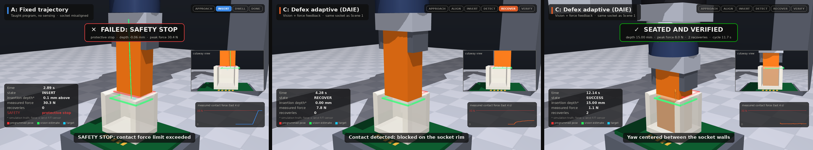
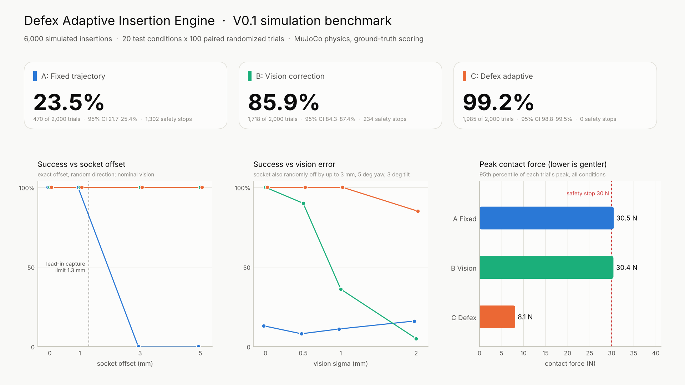
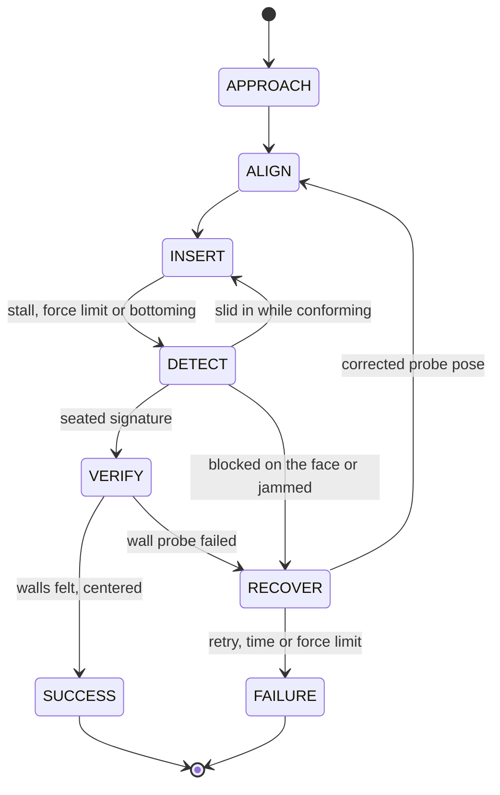

# Defex Adaptive Insertion Engine (DAIE) V0.1

DAIE is a simulation prototype of autonomous connector insertion. A 6-DOF fixture
holds a 12 x 8 mm rectangular connector and has to seat it 15 mm deep in a
receptacle with 0.5 mm of radial clearance, while the receptacle is displaced by up
to 5 mm and rotated by up to 10 degrees, the camera estimate of where it sits is
noisy, and the contact friction varies. The engine approaches, estimates alignment,
attempts the insertion, detects excessive force or insufficient progress from the
wrist force/torque sensor, retracts and corrects, retries within hard limits, and
verifies the result before it declares success.

Everything here runs in MuJoCo 3.16 with a real socket cavity, bounded actuators
and noisy sensors. Every benchmark number in this README comes from the files in
[`results/benchmark_v0.1`](results/benchmark_v0.1); the physics behavior is pinned
by the test suite (see [Validation](#validation)), and the few numbers that come
from development measurements instead are labeled as such. V0.1 is a research
prototype: it has not been validated on hardware (see
[Limitations](#assumptions-and-limitations)).

<!-- RESULTS:START -->


*Stills from the [investor video](demos/media/defex_daie_v01_investor_demo.mp4), a real
benchmark trial: the fixed program (left) trips the safety stop; on the identical
socket, Defex C is blocked on the face, retracts and corrects (middle), then seats
and verifies (right).*

## Results

<picture>
  <source media="(prefers-color-scheme: dark)" srcset="results/benchmark_v0.1/plots/dashboard_dark.png">
  
</picture>

Across 6,000 paired trials (20 conditions, 100 trials per condition and
controller), **the adaptive engine C seated and verified the connector in 1,985 of
2,000 trials (99.25%, 95% CI 98.8 to 99.5%)**. Vision correction alone (B)
succeeded in 1,718 (85.9%) and the fixed program (A) in 470 (23.5%). C never
tripped the cell's protective stop and never declared success on a connector that
was not seated; A and B tripped the stop 1,302 and 234 times.

**Large but well-measured errors are a vision problem, and B already solves them.**
On every lateral, yaw and tilt condition, up to 5 mm and 10 degrees, the camera
estimate is good (0.3 mm), and B and C both succeed in all 100 trials. A works only
while the error stays inside what the lead-in absorbs: at 1 mm and 2 degrees it
succeeds every time, at 3 mm and 5 degrees never. Laterally, the plug lands on the
socket face and the stiff program pushes until the protective stop trips. At
5 degrees of yaw it forces the plug to full depth at exactly 4.92 degrees, the
cavity's geometric limit, wedged at the corners and out of tolerance; at 5 degrees
of tilt it wedges about 14.4 mm deep.

**When the measurement itself is wrong, force feedback is what separates C from B.**
With the socket randomly off by up to 3 mm, 5 degrees of yaw and 3 degrees of tilt,
B's success falls from 100% with perfect vision to 90%, 36% and 5% as the vision
noise grows to 0.5, 1 and 2 mm. At 2 mm it does worse than A (16%): acting on a bad
estimate is worse than ignoring it. C holds 100%, 100%, 100% and 85%. On the two
generalization conditions, which no controller saw during development, B reaches
40% and 59% and C 100% in both. In these conditions C often needs at least one
recovery (43 and 77 of 100 trials at 1 and 2 mm of vision noise, 49 and 32 in the
generalization conditions): typically the plug lands on the socket face, C reads
where the face supports it, retracts and moves toward the hole. Over the whole
benchmark 212 of C's 2,000 trials needed at least one recovery, and 197 of those
(93%) still succeeded.

**The cost is cycle time.** C's median successful insertion takes 5.4 s against
4.3 s for A and B, because it inserts under force control at up to 6 mm/s, settles a
light preload and probes both walls before declaring success. Each recovery adds
roughly 3 to 4 s: the median is 9.5 s with one recovery and 12.3 s with two.

**Contact stays gentle.** Half of C's trials peak below 5.8 N of contact force and
95% below 8.1 N; the 95th percentiles of A and B sit at the 30 N stop. The highest
wrist torque C measured in any trial was 0.20 N m, against the 0.6 N m stop.

**Where C still fails.** All 15 failures are in `noise_2mm`, where the camera's
lateral error has a 2 mm standard deviation and its yaw error 3.3 degrees. Every one
ended as a clean abort at the retry or time limit, never as a false success.
Failures concentrate where the vision yaw error exceeds 4 degrees (10 of those 33
trials failed, against 5 of the other 67): the hole localizer reasons in x and y and
handles yaw with a bounded search sequence, which is the first item on the
[roadmap](#roadmap-v02).

These are simulation results with assumed physical parameters; read them with the
[limitations](#assumptions-and-limitations) in mind.

| Overall | A: Fixed trajectory | B: Vision correction | C: Defex adaptive |
|---|---|---|---|
| success rate | 23.5% | 85.9% | 99.2% |
| median cycle time, successes (s) | 4.32 | 4.31 | 5.41 |
| median peak contact force (N) | 30.3 | 7.5 | 5.8 |
| 95th pct peak contact force (N) | 30.5 | 30.4 | 8.1 |
| protective stops | 1302 | 234 | 0 |
| max measured wrist torque (N m; stop at 0.6) | 0.538 | 0.457 | 0.202 |
| mean retries | 0.00 | 0.00 | 0.22 |
| max penetration (mm) | 0.0897 | 0.1480 | 0.0612 |
| false accepts (declared success, not seated) | n/a (no self-verification) | n/a (no self-verification) | 0 |

Per condition (success rate with 95% Wilson interval; C's median cycle time, median
peak contact force, and the share of its trials that needed recovery and still
succeeded):

| Condition | A: Fixed trajectory success | B: Vision correction success | C: Defex adaptive success | C median cycle (s) | C median peak force (N) | C recovery success |
|---|---|---|---|---|---|---|
| nominal | 100% (96-100) | 100% (96-100) | 100% (96-100) | 5.37 | 5.8 | n/a |
| lateral_1mm | 100% (96-100) | 100% (96-100) | 100% (96-100) | 5.40 | 5.8 | n/a |
| lateral_3mm | 0% (0-4) | 100% (96-100) | 100% (96-100) | 5.37 | 5.8 | n/a |
| lateral_5mm | 0% (0-4) | 100% (96-100) | 100% (96-100) | 5.39 | 5.8 | n/a |
| yaw_2deg | 100% (96-100) | 100% (96-100) | 100% (96-100) | 5.38 | 5.8 | n/a |
| yaw_5deg | 0% (0-4) | 100% (96-100) | 100% (96-100) | 5.41 | 5.8 | n/a |
| yaw_10deg | 0% (0-4) | 100% (96-100) | 100% (96-100) | 5.37 | 5.8 | n/a |
| tilt_2deg | 100% (96-100) | 100% (96-100) | 100% (96-100) | 5.39 | 5.8 | n/a |
| tilt_5deg | 0% (0-4) | 100% (96-100) | 100% (96-100) | 5.39 | 5.8 | n/a |
| tilt_10deg | 0% (0-4) | 100% (96-100) | 100% (96-100) | 5.37 | 5.8 | n/a |
| noise_0mm | 13% (8-21) | 100% (96-100) | 100% (96-100) | 5.01 | 5.8 | n/a |
| noise_0.5mm | 8% (4-15) | 90% (83-94) | 100% (96-100) | 5.71 | 5.8 | 100% of 3 |
| noise_1mm | 11% (6-19) | 36% (27-46) | 100% (96-100) | 8.33 | 7.8 | 100% of 43 |
| noise_2mm | 16% (10-24) | 5% (2-11) | 85% (77-91) | 11.05 | 8.0 | 81% of 77 |
| friction_0.1 | 8% (4-15) | 100% (96-100) | 100% (96-100) | 5.38 | 5.8 | n/a |
| friction_0.3 | 8% (4-15) | 100% (96-100) | 100% (96-100) | 5.39 | 5.8 | n/a |
| friction_0.6 | 3% (1-8) | 99% (95-100) | 100% (96-100) | 5.38 | 5.9 | n/a |
| friction_1 | 2% (1-7) | 89% (81-94) | 100% (96-100) | 5.37 | 5.8 | 100% of 8 |
| generalization_combined | 0% (0-4) | 40% (31-50) | 100% (96-100) | 8.42 | 7.9 | 100% of 49 |
| generalization_tight | 1% (0-5) | 59% (49-68) | 100% (96-100) | 5.48 | 6.3 | 100% of 32 |

More plots in [`results/benchmark_v0.1/plots`](results/benchmark_v0.1/plots):
success by condition, cycle-time and force distributions, recovery statistics and
failure reasons.
<!-- RESULTS:END -->

## How the simulation works

### Workcell and socket

The receptacle is a real cavity, not a solid block with a bypass. Its collision
model is a floor plate plus four convex prisms, one per wall side, and each prism
carries its own 0.8 mm x 45 degree lead-in chamfer, so the mouth, the chamfer faces,
the mitered corners and the straight walls are all solid geometry while the cavity
itself is empty. With a 12 x 8 mm plug the cavity is 13 x 9 mm (0.5 mm per side)
and 15 mm deep; walls are 2.5 mm, the floor 2 mm, and the receptacle sits on a
1.6 mm FR4 board. Geometry is generated from
[`assets/connectors/rect_12x8.json`](assets/connectors/rect_12x8.json) by
[`defex/sim/scene_builder.py`](defex/sim/scene_builder.py), so clearance and chamfer
are parameters (the `generalization_tight` condition uses 0.2 mm and 0.5 mm). The
generated scene is checked in at
[`simulations/scenes/daie_workcell.xml`](simulations/scenes/daie_workcell.xml).

Two numbers fall out of this geometry and explain most of the baseline results. A
plug that arrives off-center is still guided in by the chamfer as long as its edge
lands inside the chamfer's outer edge, which gives a lateral capture range of
clearance + chamfer = 1.3 mm per axis. A centered 12 x 8 plug fits in the 13 x 9
cavity up to asin(4.5 / hypot(6, 4)) - atan2(4, 6) = 4.92 degrees of yaw; beyond
that its corners hit the walls. Both numbers are asserted by the tests.

### Contact model

Plug and gripper fingers collide with the socket only through 24 explicit contact
pairs, so the contact parameters are stated rather than inherited from defaults.
Normal contacts are stiff and critically damped (2 ms time constant, `solimp`
width 0.2 mm), with an elliptic friction cone (`impratio` 10), the `implicitfast`
integrator, a 0.5 ms physics step and a 2 ms (500 Hz) control period. Friction is
mu = 0.3 by default (glass-filled PBT on PBT, dry) and is swept from 0.1 to 1.0.

One parameter needed a deliberate choice. MuJoCo's soft-contact solver inflates the
normal force during fast sliding: in a development measurement, a plug snapping
off the lead-in produced 42 N where a Coulomb estimate gives about 12 N. Giving
the friction rows their own, softer reference dynamics (`solreffriction` 20 ms)
brought this to 12.5 N while keeping static creep near 0.02 mm/s at half the
friction limit. Contact damping is still velocity proportional, so impacts produce
single-sample force spikes; the harness therefore records both the instantaneous
peak and the peak of the 10 ms moving average, and judges damage on the latter
(both are reported).

### Fixture

The fixture is a Cartesian gantry (x carriage 1.5 kg, y 1.0 kg, z ram 0.5 kg, each
with 0.2 kg of reflected rotor inertia) carrying a three-axis wrist whose yaw,
pitch and roll axes intersect at the connector tip. That remote-center layout is
kinematically equivalent to a hexapod pivoting at the tip, and it gives a
closed-form inverse kinematics. Every joint is driven by a position servo with
explicit saturation: 10 N/mm and 60 N per linear axis, 15 N m/rad and 2 N m per
wrist axis, critically damped. Gantry links are gravity compensated; the payload
below the force sensor (30 g tool plus the 4 g connector) is not, exactly as on a
real wrist. Setpoints come from an online trapezoidal motion generator limited to
50 mm/s, 45 deg/s, 500 mm/s^2 and 600 deg/s^2, so nothing teleports: every trial
starts 60 mm above the nominal socket and moves there through the servos.

The servos are deliberately stiff. Baselines A and B run on that stiffness exactly
as a conventional cell would; controller C gets its compliance only from software,
through admittance control on the setpoints.

### What a controller can see

Controllers receive one `Observation` per 2 ms tick and nothing else. Its contents
are built in [`defex/perception`](defex/perception) from noisy hardware signals:

| Signal | When | Noise model (1 sigma) |
|---|---|---|
| Socket pose from vision | once, before motion | 0.3 mm x/y/z, 0.5 deg yaw, 0.3 deg tilt; optional fixed hand-eye bias |
| Connector pose in the gripper | once, after grasp | 0.1 mm, 0.3 deg |
| Wrist force/torque | 500 Hz | 0.03 N and 0.5 N mm white noise; per-trial bias of 0.3 N and 3 N mm, removed by taring in free space; 40 Hz low-pass |
| Joint encoders | 500 Hz | 2 um and 0.002 deg at the tip |

From these the state estimator derives the connector pose (encoders composed with
the grasp estimate), the connector pose relative to the estimated socket, the
insertion depth estimate, and the contact wrench at the connector tip expressed
in the socket frame (gravity-compensated with the identified payload, tared,
filtered). The controller's own FSM state is logged with every tick.

At reset a controller also receives static configuration, the things a cell
integrator would know in advance: the connector's drawing dimensions, the
programmed (nominal) socket pose, the fixture limits, and the vision system's
characterized accuracy (its noise sigma and bias magnitude, never the error
itself). C uses the accuracy figure to size its search prior and its approach
height. Each condition hands it the correct figure, so the benchmark does not test
a camera whose accuracy has been mis-characterized.

Ground truth (true poses, contact forces, penetration, contact count) lives in a
separate `GroundTruth` type that only the scoring code reads. The separation is
enforced by tests: one asserts that `Observation` carries no ground-truth field,
another parses every module in `defex/control`, `defex/recovery` and
`defex/perception` and fails if any of them imports MuJoCo, the MuJoCo backend or
`GroundTruth`. Recovery in controller C is therefore triggered and steered by
measured wrench, encoder positions and the one-shot vision estimate only. It never
sees the true disturbance and never re-measures with vision.

### Scoring and safety

After a controller finishes, the fixture holds its last setpoint for 0.25 s and the
trial is scored on ground truth. A trial succeeds only if all of these hold:

* depth at least 14.5 mm (15 mm minus 0.5 mm), lateral offset within clearance +
  0.15 mm on each socket axis, tilt and yaw within 3 degrees, tip speed below
  2 mm/s;
* no protective stop: measured force above 30 N or torque above 0.6 N m stops the
  cell immediately, for every controller, like a cobot protective stop;
* no damage: the 10 ms average contact force never exceeded 45 N;
* no interpenetration deeper than 0.2 mm (a validity bound on the physics), no
  workspace limit, and completion within 30 s;
* the controller did not declare failure.

Only controller C declares success or failure, so only C can produce a false
accept (declares success, not seated) or a false reject (declares failure while
seated); both are counted. A and B never declare and are scored on ground truth
alone, which is generous to them.

### Physical assumptions

All values live in [`defex/config.py`](defex/config.py) and
[`assets/connectors/rect_12x8.json`](assets/connectors/rect_12x8.json). The basis
column says where each number comes from; "assumed" means a plausible engineering
value that has not been measured on real parts.

| Quantity | Value | Basis |
|---|---|---|
| Connector housing | 12 x 8 x 25 mm, 4 g | cross-section from the brief; length and mass assumed for a glass-filled PBT housing with terminals |
| Socket cavity | 0.5 mm clearance per side, 15 mm deep | brief |
| Lead-in, walls, floor | 0.8 mm x 45 deg chamfer, 2.5 mm walls, 2 mm floor, 1.6 mm FR4 | assumed, typical of wire-to-board receptacles |
| Friction | mu = 0.3, swept 0.1 to 1.0 | assumed for dry PBT on PBT (about 0.25 to 0.35); the sweep spans lubricated to rubber-like |
| Normal contact | 2 ms time constant, critically damped, `solimp` width 0.2 mm | stiffness choice: nominal penetration below 0.01 mm (tested), time constant at least 2x the step for stability |
| Friction dynamics | `solreffriction` 20 ms | removes the solver's normal-force inflation during sliding (42 N to 12.5 N, development measurement) |
| Physics and control rate | 2 kHz and 500 Hz | 500 Hz matches industrial external-control interfaces such as UR e-Series RTDE |
| Moving masses | x 1.5 kg, y 1.0 kg, z 0.5 kg, each + 0.2 kg reflected rotor inertia; wrist links 50 g; tool 30 g | assumed small precision gantry |
| Servo stiffness and limits | 10 N/mm and 60 N per linear axis; 15 N m/rad and 2 N m per wrist axis | assumed stiff position-controlled axes, as in a conventional cell |
| Motion limits | 50 mm/s, 45 deg/s, 500 mm/s^2, 600 deg/s^2 | assumed conservative precision-assembly speeds |
| Vision | 0.3 mm x/y/z, 0.5 deg yaw, 0.3 deg tilt (1 sigma), swept to 2 mm | assumed calibrated cell camera; the sweep covers poor calibration and placement error |
| Wrist F/T | 0.03 N and 0.5 N mm noise, 0.3 N bias, 40 Hz low-pass | assumed small six-axis sensor (ATI Mini40 class, noise on the conservative side) |
| Protective stop | 30 N or 0.6 N m measured | assumed cobot-style cell limit |
| Damage | 45 N contact force sustained over 10 ms | assumed conservative limit for a small plastic housing on a PCB |
| Success tolerances | depth within 0.5 mm, lateral within clearance + 0.15 mm, tilt and yaw within 3 deg | assumed seating specification |

## The three controllers

**A: fixed trajectory** ([`defex/control/baselines.py`](defex/control/baselines.py)).
The taught program: transit to 5 mm above the nominal socket at 40 mm/s, descend at
8 mm/s to 0.5 mm past the nominal seat (preload), dwell 0.3 s. It uses neither
vision nor force. If the socket moved more than the 1.3 mm capture range, the plug
lands on the top face and the stiff servo pushes until the protective stop trips.

**B: vision position correction** (same file). The same program aimed at the
vision-estimated socket pose (position, yaw and tilt) and corrected for the
estimated in-hand connector pose. No force feedback and no recovery: it succeeds
whenever the vision error is inside the capture range and fails otherwise.

**C: Defex adaptive (DAIE)** ([`defex/control/adaptive_fsm.py`](defex/control/adaptive_fsm.py)).
A finite-state machine with force-guided insertion, active compliance, contact
diagnosis, bounded recovery and explicit verification:



APPROACH moves above the vision-estimated socket and aligns the connector axis and
yaw with the estimate. ALIGN moves to the current probe position, settles, and
tares the wrench in free space. INSERT descends under force control (speed
proportional to the error from a 6 N axial target, capped at 6 mm/s) with lateral
and yaw admittance active on contact, and tilt admittance once the plug is
confidently inside the cavity. A monitor watches progress (less than 0.15 mm of
depth gained in 0.4 s while the axial force exceeds 70% of the target counts as a
stall) and limits (20 N total force, 10 N lateral, 0.35 N m), all well below the
cell's 30 N protective stop.

DETECT holds briefly and classifies the contact from its wrench signature: on the
top face, partially inserted and jammed, or seated. Because the depth estimate is
only as good as the vision height until the face has been touched, the "inside the
cavity" decision uses depth > 1.5 mm + 3 sigma of the depth uncertainty, and a
touch on the face recalibrates the height.

RECOVER retracts along the axis and plans the next attempt from what the contact
revealed. This is the core of the engine:

* **Blocked on the top face.** A single force reading does not say where the hole
  is, but it does say where the plug is supported. C first lets the plug conform
  flat to the face (a zero-stiffness tilt admittance) so a residual tilt error does
  not masquerade as an offset, then measures the center of pressure from the wrist
  torque. For a plug resting on a face with a rectangular hole in it, the center of
  pressure is the projection of the plug center onto the supporting region; in a
  development check this forward model matched MuJoCo's contacts to 0.07 mm on
  average (0.22 mm worst case), and a test keeps it within 0.3 mm. A Bayesian
  histogram filter over the hole position (0.25 mm grid, +/-7 mm) combines that
  measurement, the fact that the plug was blocked at that probe, and the chance of
  sticking on the chamfer band, using a Gaussian likelihood with an
  outlier floor. The next probe is the position with the highest probability of
  entering, excluding positions that already blocked. If two probes at a confident
  position (entry probability above 0.6) still block, the remaining error is
  probably rotational and C steps through a bounded yaw sequence (+/-3, 6, 9,
  12 degrees).
* **Entered but jammed.** The plug's compliance has already discovered part of the
  correct pose while it was jammed; C re-aims with the lateral and rotational
  offsets the admittance accumulated, within the recovery bounds.

Recovery is bounded: at most 8 attempts and 26 s, lateral corrections up to
6.5 mm, yaw up to 12 degrees, tilt up to 6 degrees.

VERIFY must pass before C declares success. It checks the bottoming signature,
aligns the plug's tilt to the cavity floor, then runs guarded probes along the
socket's short axis: both opposing walls must push back with at least 2 N within
the clearance budget (1.35 mm of travel for the 0.5 mm socket), which a plug
perched on a ledge or caught in the chamfer cannot produce. The probe positions
also locate the cavity center, and C centers the plug between them. When the
vision yaw is uncertain (sigma above 1 degree) it also finds both rotational
limits and centers the yaw between them.

## Experiment protocol

[`defex/tasks/conditions.py`](defex/tasks/conditions.py) defines 20 conditions:

| Condition | True socket disturbance | Sensing and contact |
|---|---|---|
| `nominal` | none | nominal (vision sigma 0.3 mm) |
| `lateral_1mm`, `_3mm`, `_5mm` | exactly 1, 3 or 5 mm in a random horizontal direction | nominal |
| `yaw_2deg`, `_5deg`, `_10deg` | exactly 2, 5 or 10 degrees about the insertion axis, random sign | nominal |
| `tilt_2deg`, `_5deg`, `_10deg` | exactly 2, 5 or 10 degrees about a random horizontal axis | nominal |
| `noise_0mm`, `_0.5mm`, `_1mm`, `_2mm` | moderate: uniform up to 3 mm lateral, 5 deg yaw, 3 deg tilt | vision sigma 0, 0.5, 1 or 2 mm, with z, yaw and tilt sigma scaled alike (at 2 mm: z 2 mm, yaw 3.3 deg, tilt 2 deg) |
| `friction_0.1`, `_0.3`, `_0.6`, `_1` | moderate (as above) | mu = 0.1, 0.3, 0.6 or 1.0 |
| `generalization_combined` | uniform up to 5 mm, 10 deg yaw, 8 deg tilt, 1 mm height, plus in-hand grasp error (1 mm slip, 1 mm axial, 3 deg) | vision sigma 0.8 mm plus 0.8 mm calibration bias, mu = 0.5 |
| `generalization_tight` | uniform up to 3 mm, 6 deg yaw, 4 deg tilt | unseen geometry: 0.2 mm clearance, 0.5 mm chamfer; vision sigma 0.5 mm |

"Unseen" in the two generalization conditions means unseen during development:
the controllers never ran on them while being tuned, but they are given the
connector's drawing dimensions (including the tighter socket) as they would be in
production.

Trials are paired. Trial *i* of a condition derives its disturbance and every
sensor noise stream from `SeedSequence(base_seed, crc32(condition), i)`, so A, B and
C face the identical socket, grasp and sensor noise in that trial, and differences
between controllers are paired comparisons. Success rates carry Wilson 95%
confidence intervals.

Development and tuning used base seed 2026, with seed 99 as a hold-out check after
the controller was frozen. Two full benchmark runs then exposed defects that are
now fixed. Both are recorded here because they bear on how far to trust the
numbers:

1. **Run 1** (seed 20261024, commit `33a624b`). C's verification probes started
   before the axial force had settled to its light preload, so at mu = 1.0 floor
   friction, not the walls, stopped every probe. No false accepts resulted (A
   succeeded in 484, B in 1,748 and C in 1,987 of 2,000 trials each), but the check
   was not doing what it claimed. The fix (commit `01105e6`) was validated on seed
   2026, and because seed 20261024 had by then been inspected, the benchmark moved
   to a fresh seed.
2. **Run 2** (seed 20261025, commit `01105e6`). C tripped the protective stop once:
   a trial ran out of time with the plug wedged 14 mm deep, and C's abort zeroed
   its compliance offsets before retracting, which twisted the plug against the
   walls past the 0.6 N m torque limit. The fix (commit `4510f7f`) backs out along
   the current compliant pose, as the normal recovery retract always did. A trial
   that enters the abort path is already lost, so this fix cannot change any
   success outcome; the benchmark was therefore re-run on the same seed.

The reported benchmark is **run 3**: seed 20261025, commit `4510f7f`, 20 conditions
x 3 controllers x 100 trials = 6,000 trials. Its success outcomes match run 2 trial
for trial (A and B identically in every field); the trial that tripped the stop in
run 2 now ends as a clean abort, and eight other aborted trials end up to 0.14 s
sooner because their retract no longer re-orients the plug. The superseded reports
are kept in
[`results/benchmark_v0.1/earlier_runs`](results/benchmark_v0.1/earlier_runs).
Per-trial results are in `trials.csv`; aggregates in `summary.json` and
`summary.csv`; plots and a full per-condition table in `plots/` and `report.md`;
every controller event of every trial in `events.json.gz`.

Metrics, per condition and controller: success rate, cycle time (from the first
motion to the controller's declaration, or to the end of the program for A and B),
peak contact force (instantaneous and 10 ms), peak measured force, retries,
recovery success rate (share of trials that needed at least one retry and still
succeeded), final depth, penetration, protective stops, false accepts and rejects,
and the failure reason of every failed trial.

## Quick start

Tested on Linux with Python 3.12.3, MuJoCo 3.16.0, NumPy 2.5.4 and Matplotlib 3.11.2.
The project targets the existing `.venv` on the Mac mini (Python 3.12, MuJoCo
3.16.0); nothing here needs a different interpreter.

```bash
source .venv/bin/activate
pip install -e ".[dev,video]"     # mujoco, numpy, matplotlib; pytest; imageio + ffmpeg for MP4

pytest -q                         # 36 tests (physics, geometry, sensing, controllers)
pytest -q -m "not slow"           # skip the closed-loop controller tests
python -m experiments.baseline    # one-minute check: all controllers at 100% on easy conditions
```

### Live demos (MuJoCo viewer)

On macOS the passive viewer must own the main thread, so live demos start with
`mjpython` (installed next to `python` in the virtual environment). On Linux use
`python`.

```bash
mjpython -m demos.run_demo nominal                  # C on an aligned socket
mjpython -m demos.run_demo disturbed                # A on a socket 3 mm / 5 deg off: protective stop
mjpython -m demos.run_demo adaptive                 # C on the benchmark trial used in the investor video
mjpython -m demos.run_demo compare                  # A, B and C back to back on the same socket
mjpython -m demos.run_demo compare --condition noise_2mm --trial 3 --seed 2026
python   -m demos.run_demo compare --headless       # no window: prints results and event logs
```

Every mode accepts `--speed 0.5` (slow motion), `--controller fixed|correction|adaptive`,
and either a benchmark trial (`--condition`, `--trial`, `--seed`) or explicit
disturbances (`--lateral`, `--direction`, `--yaw`, `--tilt`, `--vision-sigma`,
`--friction`). In the viewer the red outline is the programmed socket pose, the
green outline is the vision estimate, the cyan dot is the commanded setpoint and the
orange trail is the connector tip path; telemetry and the FSM state are overlaid.

`python simulations/view.py` opens the static workcell in MuJoCo's interactive
viewer (plain `python` works on macOS here); `--scene legacy` opens the original
prototype model.

### Benchmark, plots and replay

```bash
python -m experiments.robustness --trials 100 --seed 20261025 --name benchmark_v0.1 --record 1
python -m experiments.evaluate results/benchmark_v0.1        # re-plot without re-running
python -m experiments.robustness --list                      # condition names
python -m experiments.robustness --conditions lateral_3mm,noise_2mm --trials 20 --name dev_quick
```

The reported benchmark took 27 minutes on four worker processes in a 4-vCPU Linux
sandbox; `--workers` defaults to the CPU count minus one. `--record N` saves the
first N trials of every condition and controller as replayable trajectories:

```bash
python -m demos.replay --list results/benchmark_v0.1
mjpython -m demos.replay results/benchmark_v0.1/trajectories/noise_2mm__adaptive__000.npz
python -m demos.replay results/benchmark_v0.1/trajectories/lateral_3mm__fixed__000.npz --render replay.mp4
```

### Videos and the investor demo

```bash
python -m demos.record_video --controller adaptive --condition noise_2mm --trial 3 --seed 2026
python -m demos.record_video --compare --lateral 3 --yaw 5 --out demos/media/compare.mp4
python -m demos.investor_video        # writes demos/media/defex_daie_v01_investor_demo.mp4
```

On headless Linux prefix these with `MUJOCO_GL=egl` (or `osmesa`); macOS renders
offscreen with plain `python`.

The rendered video, [`demos/media/defex_daie_v01_investor_demo.mp4`](demos/media/defex_daie_v01_investor_demo.mp4),
runs 64 s: a title card and a short orbit of the workcell; Scene 1, the fixed
program meeting a misaligned socket and tripping the protective stop; Scene 2, the
adaptive controller on the same socket detecting the failure from contact forces,
retracting, correcting and verifying; Scene 3, the benchmark dashboard. Both runs
are a real benchmark trial (`noise_2mm` trial 43 of the reported run) reproduced
from its seed, not a staged animation. The trial is chosen by
[`demos/showcase.py`](demos/showcase.py) with explicit criteria (A protective stop,
B fails, C succeeds after one to three recoveries), so it is an illustrative case,
not an average one; the dashboard that follows shows the averages.

## Repository layout

```
assets/connectors/        connector + socket dimensions (JSON)
defex/
  config.py               all parameters as typed dataclasses with unit suffixes
  sim/                    simulator interface, MuJoCo backend, scene generator
  perception/             sensor noise models, state estimator (no ground truth)
  control/                motion generator, admittance, controllers A/B/C, registry
  recovery/               failure monitor, contact diagnosis, hole localizer
  tasks/                  conditions, paired scenario sampling, trial harness + scoring
  logging/                trial records, summaries, Wilson intervals, CSV/JSON
  utils/                  rigid-body transforms
experiments/              baseline check, robustness benchmark, evaluation + plots
demos/                    live viewer, video recorder, replay, investor video
  media/                  rendered investor video and its README still
simulations/              generated workcell MJCF, original prototype, viewer script
tests/                    36 tests: geometry, physics, sensing, controllers, metrics
results/benchmark_v0.1/   the reported benchmark: trials.csv, summary.json/.csv, report.md,
                          plots/, events.json.gz, trajectories/ (replayable),
                          earlier_runs/ (superseded reports)
```

## Validation

The tests pin the physics to hand calculations rather than to whatever the
simulator happens to do:

* **Geometry.** The cavity is open and the walls, floor and chamfer are solid
  (probed kinematically); the radial clearance is 0.5 mm (no contact at 0.45 mm,
  contact at 0.55 mm on both axes); the yaw capacity is 4.92 degrees (no contact
  at 4.3, contact at 5.2); a seated plug bottoms on the floor; every
  plug-or-finger to socket pair exists explicitly and no geom takes part in
  automatic collision detection, so nothing invisible can collide.
* **Physics.** A nominal insertion seats at 15 mm (within 0.02 mm) with a
  bottoming force equal to the programmed 0.5 mm overtravel times 10 N/mm plus the
  payload weight (within 0.05 N) and less than 0.01 mm of interpenetration; a 1 mm offset is
  guided in by the chamfer with a peak below 18 N (the Coulomb estimate is about
  12 N); a 1.5 mm offset is blocked on the rim.
* **Sensing.** The F/T sign convention and gravity compensation match ground truth
  at a tilted pose; the measured center of pressure matches the localizer's
  forward model within 0.3 mm.
* **Architecture.** No ground truth in observations, no simulator imports in
  control, recovery or perception; trials are bit-for-bit deterministic on a given
  machine; paired scenarios are identical across calls.
* **Behavior.** All controllers insert on the nominal socket; A trips the
  protective stop at 3 mm; B handles a 5 mm offset and a 10 degree tilt it measured
  well; C recovers from an observed failure and declares success only after VERIFY.
* **Regressions from the benchmark runs.** At mu = 1.0, C's verification probes
  must travel through the clearance to the walls rather than stop on floor
  friction; the run-2 trial whose abort tripped the stop must now end as a clean
  abort.

## Assumptions and limitations

These are the places where V0.1 is simpler than a production cell, roughly in the
order they matter for transfer to hardware.

1. **No terminal or latch forces.** Only the housing is modeled. Real connectors
   add terminal insertion force and a latch snap; seat detection on real parts
   should use that signature, and the force budget will change.
2. **Rigid grasp.** The in-hand pose error is sampled once per trial
   (`generalization_combined`), but the connector cannot slip or rotate in the
   gripper during contact.
3. **Abstract fixture.** A gantry with a remote-center wrist and ideal servos, not
   a serial arm. Arm dynamics, joint flexibility and controller latency beyond the
   2 ms period are not modeled.
4. **Contact physics.** MuJoCo soft contacts with velocity-proportional damping:
   impacts produce single-sample force spikes (hence the 10 ms damage criterion),
   and there is slow friction creep (about 0.02 mm/s at half the friction limit).
   Contact parameters are not calibrated against measured parts.
5. **Vision is a single Gaussian shot.** No outliers, occlusion or re-measurement.
   A real vision stack would mostly help C (it could re-measure after a failure),
   but its failure modes are not represented.
6. **The hole localizer is two-dimensional.** It estimates x and y; yaw is handled
   by a bounded search sequence. All of C's failures occurred under 2 mm vision
   noise, and they concentrate where the vision yaw error exceeds 4 degrees (10 of
   33 such trials failed, against 5 of 67 otherwise).
7. **Correctly characterized vision.** C is told each condition's true vision
   accuracy (sigma and bias magnitude). A camera that is worse than its
   characterization would leave C's search prior too narrow; that case is not in
   the benchmark.
8. **One connector family.** Generalization is tested on unseen clearance, chamfer,
   friction and combined disturbances, not on other connector shapes.
9. **Determinism is per platform.** Trials are bit-for-bit reproducible on a given
   machine and build. Floating-point differences between CPU architectures (for
   example x86-64 versus Apple Silicon) can change individual trial outcomes, so a
   re-run on the Mac mini should reproduce the rates within their confidence
   intervals, not trial by trial. This has not yet been checked on Apple Silicon.

## Roadmap (V0.2)

1. Localize the hole in (x, y, yaw) jointly instead of (x, y) plus a yaw sequence;
   this targets the `noise_2mm` tail directly.
2. Terminal and latch force model, and seat verification from the latch signature.
3. Grasp compliance and in-hand slip.
4. A serial arm (UR5e class) through the same backend interface, then an Isaac Sim
   backend.
5. A connector library (board-to-board, USB-C, RJ45) generated from asset files.
6. Hardware in the loop with a real wrist F/T sensor, and calibration of the
   contact parameters against measured insertions.
7. Only then learning: residual policies or learned search priors, compared with C
   on the same paired benchmark.

## Porting to another simulator

The task harness talks to physics only through the `SimBackend` protocol in
[`defex/sim/backend.py`](defex/sim/backend.py): `load(SceneParams)`, `reset()`,
`set_tcp_setpoint(pose)`, `step(duration)`, `read_sensors()` (noise-free hardware
signals), `ground_truth()` (scoring only), `joint_positions()` and
`set_marker_pose()` (logging and visuals), plus the `home_tcp_pose`,
`nominal_socket_pose` and `payload` properties. An Isaac Sim backend would build the
same workcell as USD, map `set_tcp_setpoint` onto its articulation controller,
read its wrist joint force sensor for `read_sensors`, and use its contact report
for `ground_truth`. Controllers, perception, recovery, scoring and the experiment
runner would not change.
