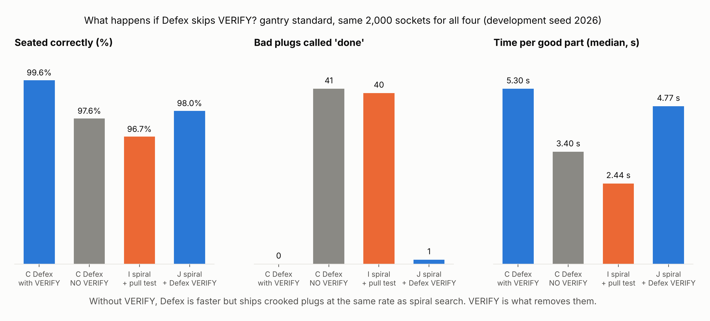

# Does C need its VERIFY? (development measurement, not pre-registered)

**Question (Hasan, 2026-11-06):** VERIFY costs time. Would C's insertion alone, without
VERIFY, give better results?

**Method.**
- New config switch `skip_housing_verify`, default off (commit bb5c28c). With it on, C
  declares SUCCESS at the seated signature from DETECT, the moment it feels the plug
  bottomed. It skips the whole housing-only VERIFY: seat conform, wall probes, centring
  and yaw. Latching parts would keep their latch check, but this run has none.
- Run as the variant `adaptive@noverify` through `DEFEX_CONTROLLER_VARIANTS`. The
  variants file is `{"noverify": {"skip_housing_verify": true}}`.
- Controllers, paired on the same sockets and noise: C, C without VERIFY, I (spiral + RCC
  + pull) and J (F's insertion + C's VERIFY).
- `standard` suite on the development seed 2026, not a benchmark seed:
  - gantry: 100 trials per condition, 2,000 per controller;
  - arm: 50 per condition, 1,000 per controller.
- MuJoCo 3.17.0 on Linux x86-64. No pre-registration and one seed, so read the numbers as
  a development measurement.

Command (gantry; for the arm use `--backend arm --trials 50`):

```bash
DEFEX_CONTROLLER_VARIANTS=variants.json python -m experiments.robustness --suite standard \
  --backend gantry --trials 100 --seed 2026 --no-plots \
  --controllers adaptive,adaptive@noverify,spiral_rcc_pull,spiral_rcc_verify \
  --name v0.2g_noverify_dev/gantry_standard
```

## Gantry, standard, seed 2026 (2,000 paired trials per controller)

| Controller | Seated correctly | Bad plugs called "done" | ...of which over 3 deg | Median time, good parts (s) | Good parts per hour |
|---|---|---|---|---|---|
| C | 1992/2000 (99.6%) | 0 | 0 | 5.30 | 614 |
| C without VERIFY | 1952/2000 (97.6%) | 41 | 41 | 3.40 | 888 |
| I spiral + pull | 1933/2000 (96.7%) | 40 | 40 | 2.44 | 1,113 |
| J spiral + C's VERIFY | 1960/2000 (98.0%) | 1 | 0 | 4.77 | 647 |

Paired, C against C without VERIFY: C-only 40, without-VERIFY-only 0 (exact McNemar
p = 1.8e-12). On this seed, VERIFY never cost C a trial.

Where any of the four differ (seated correctly / bad plugs called "done", per 100):

| Condition | C | C without VERIFY | I | J |
|---|---|---|---|---|
| nominal | 100 / 0 | 100 / 0 | 100 / 0 | 99 / 0 |
| lateral_3mm | 100 / 0 | 100 / 0 | 100 / 0 | 99 / 0 |
| tilt_2deg | 100 / 0 | 100 / 0 | 100 / 0 | 98 / 0 |
| tilt_5deg | 100 / 0 | 100 / 0 | 100 / 0 | 99 / 0 |
| noise_0.5mm | 100 / 0 | 100 / 0 | 100 / 0 | 97 / 0 |
| noise_1mm | 99 / 0 | 92 / 7 | 90 / 10 | 100 / 0 |
| noise_2mm | 94 / 0 | 63 / 32 | 45 / 28 | 71 / 1 |
| friction_0.3 | 100 / 0 | 100 / 0 | 100 / 0 | 99 / 0 |
| friction_1 | 99 / 0 | 98 / 1 | 100 / 0 | 100 / 0 |
| generalization_combined | 100 / 0 | 99 / 1 | 98 / 2 | 98 / 0 |



## Reading (gantry)

- **Without VERIFY, C passes bad units at the same rate as spiral search:** 41 against
  I's 40. Every one is a plug more than 3 deg off, the same full-depth crooked failure.
  C's insertion alone does not prevent it.
- **Without VERIFY, C is faster but still slower than spiral.** The median good cycle is
  3.40 s, against 5.30 s with VERIFY and 2.44 s for I. Good parts per hour: 888, against
  614 and 1,113.
- **C's insertion still finds the hole more often than spiral when the camera is bad.**
  On noise_2mm, C without VERIFY ends at full depth (14.5 mm or more) in 93 of 100
  trials, against I's 70. But only 63 of those 93 are in spec, and it calls 32 bad
  plugs "done" (counted from `trials.csv`).
- **VERIFY turns those crooked plugs into good ones.** C with VERIFY seats 94 of 100 on
  noise_2mm, and J (spiral + VERIFY) 71. VERIFY straightens the plug, and when it can't,
  it rejects it and retries.
- **J is not perfect.** J lost 1-3 trials in several easy conditions (nominal, tilt,
  noise_0.5mm) where everyone else seated 100. Its one bad unit is under 3 deg, so it
  failed another check. These losses were not traced.

**Answer, on this seed:** dropping VERIFY is a bad trade. It saves about 1.9 s per part,
but it makes C ship as many crooked plugs as spiral search, while still being slower
than spiral. VERIFY is where C's advantage comes from. C's insertion helps mainly by
getting the plug in more often under a bad camera.

## Arm, standard, seed 2026

(Added when the run finishes. Its first two attempts failed because the UR5e model had
not been fetched in this session; `scripts/fetch_menagerie.py` fixes that.)
